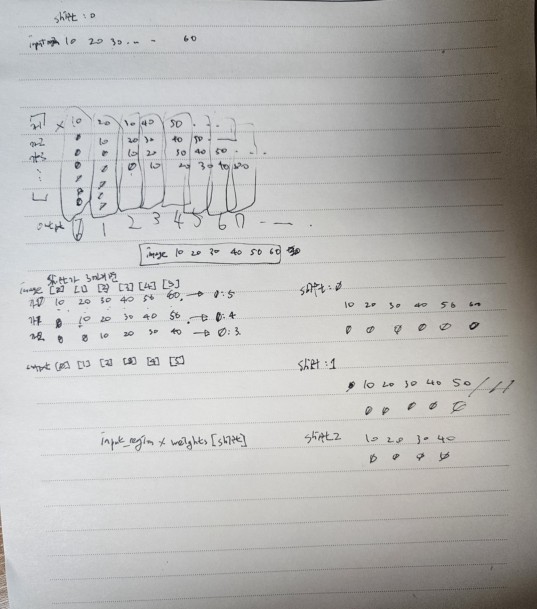

# 10월 31일 과제

- CNN 기초
- MNIST 평가 그래프 그리기
- MNIST 학습 모델 Feature Map확인
- 잔상 효과 NumPy, CuPy 코딩

## 파일 구조

```text
2026.10.31/
├── cnn_filter_assignment.py   # Smoothing/Sharpening CNN 필터 실습
├── mnist_cnn_assignment.py    # MNIST 학습, 평가 그래프, Feature Map 시각화
├── motion_trail_assignment.py # NumPy/CuPy 잔상 효과 및 속도 비교
└── README.md                  # 파일 설명, 실행 방법, 참고 사항
```

- **cnn_filter_assignment.py**: `../src/images/seagull.jpg`를 흑백으로 불러와, 수업에서 작성한 `convolution2d()`에 Smoothing/Sharpening 필터와 편향을 적용하는 코드. Convolution 결과와 ReLU Feature Map을 비교한다.
  - TODO는 Smoothing/Sharpening CNN의 구현임.
- **mnist_cnn_assignment.py**: `../src/datasets`의 MNIST를 불러와 수업 시간에 했던 것처럼 `SimpleCNN`을 3 epoch 학습한다. Train/Test loss와 accuracy를 그리고, 학습된 모델의 `conv1`, `relu1`, `pool1`, `conv2`, `relu2`, `pool2` Feature Map을 `viridis`로 출력한다. 학습된 가중치는 `../src/models/MNIST/MNIST_CNN.pth`에 저장한다.
  - TODO는 학습 후 에폭별 loss와 accuracy 그래프 그리는 코드와 학습된 모델의 Feature Map을 확인하는 코드이다.
- **motion_trail_assignment.py**: 같은 갈매기 이미지를 1280×720으로 바꾸고, 길이 32의 잔상을 NumPy 픽셀 반복과 CuPy 배열 슬라이싱으로 각각 계산한다. CPU/GPU 결과가 같은지도 확인하고 처리 시간을 비교한다.
  - TODO는 NumPy와 CuPy를 통해 적은 잔상효과 코드 구현 부분이다.

<br>

## 실행 방식

현장 Jetson에 필요한 라이브러리와 CUDA/CuPy 환경이 준비되어 있다는 전제로 작성했다. 모든 데이터 경로를 과제 폴더 기준 상대 경로로 적었으므로 **먼저 과제 폴더로 이동한다.**

```bash
cd 2026.10.31
```

CNN Smoothing/Sharpening 필터:

```bash
python3 cnn_filter_assignment.py
```

MNIST CNN 학습, 평가 그래프, Feature Map 확인:

```bash
python3 mnist_cnn_assignment.py
```

NumPy/CuPy 잔상 효과 및 속도 비교:

```bash
python3 motion_trail_assignment.py
```

MNIST는 `download=True`로 설정했다. `../src/datasets`에 데이터가 이미 있으면 그대로 읽고, 없을 때만 해당 위치로 내려받는다. MNIST 파일은 과제 폴더에 복사하지 않았다.

<br>

## 기타 참고 사항

### CNN Smoothing/Sharpening

결과를 보니, Smoothing은 Sharpening과 다르게 ReLU를 하나 마나 똑같았다.

왜지...? 하고 보니.. Smoothing은 어처피 가우시안이든 박스 필터이든, 양수를 곱하기 때문이었다. ReLU는 음수만 없애고 양수는 그대로 뱉어내므로, Smoothing에는 큰 효과가 없음을 깨달았다.

하지만, Sharpening은 주변은 음수, 가운데만 양수, 커널의 합은 1로 만들기 때문에, 음수 처리가 있어, ReLU의 효과가 커서 차이가 큼을 볼 수 있었다.

### NumPy 잔상 효과에서 헷갈렸던 부분

CPU 코드는 출력 한 칸을 다음 식처럼 직접 계산한다.

```text
output[y, x] = image[y, x-0] × weight[0]
             + image[y, x-1] × weight[1]
             + ...
             + image[y, x-31] × weight[31]
```

`x-shift`가 음수가 되면 NumPy의 음수 index가 배열 뒤쪽을 읽어 버린다. 그러면 왼쪽 경계가 오른쪽 끝과 이어지는 이상한 결과가 생기므로 그 값은 반드시 0으로 처리했다.

그리고 처음에는 `input_array[shift] = 0`처럼 쓰려고 했는데, `input_array = []`는 길이가 0인 빈 리스트라 아직 그 index가 존재하지 않는다. 그래서 `append(0.0)` 또는 `append(weighted_pixel)`로 한 칸씩 추가해야 했다. 빈 리스트를 만들어 놓고 저장 공간이 이미 생겼다고 생각했던 부분이 헷갈렸다...ㅎㅎ

가중치 32개는 2차원 CNN kernel은 아니지만, x축 방향으로만 적용하는 1차원 filter라고 생각할 수 있다. 정확히는 현재 픽셀과 왼쪽의 과거 픽셀들을 가중합하는 FIR filter와 비슷한 형태다. 이미지의 세로 방향으로는 이동하지 않으므로 각 행에 같은 1차원 연산을 적용한다.

어쨌든 이 CPU 코드를 풀면서 수식이 다음과 같음을 알게 되었다.

$$
\text{output}[x,i] = \sum_{s=0}^{31} \text{image}[x,i-s] \times \text{weights}[s]
$$

이다..

근데, 병렬 연산이 되는 gpu는... 어떻게...??? 보니까 슬라이싱을 이용했었다. **슬라이싱**이 엄청난 힌트가 되었다!!

### CuPy 슬라이싱 설명

GPU에서는 출력 픽셀 하나씩 Python 반복문으로 계산하지 않고, `shift` 하나마다 이미지 전체 영역을 계산한다.

```python
input_region = image[:, :image_width - shift]
output_region = output[:, shift:]
output_region += input_region * weights[shift]
```

예를 들어 width가 5이고 `shift=2`라면 `input_region`은 원본의 0~2번째 열이고, `output_region`은 출력의 2~4번째 열이다. 두 영역의 shape가 같으므로 원본이 오른쪽으로 두 칸 이동한 위치에 더해진다. 출력의 왼쪽 두 칸은 처음 만든 0이 그대로 남아서 별도 padding 배열 없이도 zero padding이 된다.

`output_region`은 복사본이 아니라 `output`의 view이므로 `+=` 결과가 원래 output 배열에 바로 누적된다. 바깥의 `for shift`는 여전히 순차 실행되지만, 각 단계의 전체 픽셀 곱셈과 덧셈은 GPU에서 병렬 처리된다.

왼쪽 경계에서는 존재하지 않는 항을 0으로 두기 때문에 가중치 합이 1보다 작아진 것처럼 보여 조금 어두워질 수 있다. 경계에서만 남은 가중치를 다시 정규화하는 방법도 있지만, 그러면 zero padding을 사용한 원래 수식과 다른 효과가 된다. 이번 과제는 노트북 설명과 같은 zero padding 방식을 그대로 따랐다.

### 코드 검증 Output 생성

그림이 그럴듯하게 보이는 것만으로는 CPU/GPU 계산이 정말 같은지 알기 어려워서 작은 배열의 정답을 손으로 먼저 구했다.



```text
image   = [10, 20, 30, 40, 50]
weights = [0.6, 0.3, 0.1]
output  = [6, 15, 25, 35, 45]
```

이 값을 기준으로 NumPy 반복문과 배열 slicing의 계산 방향을 확인했다.
