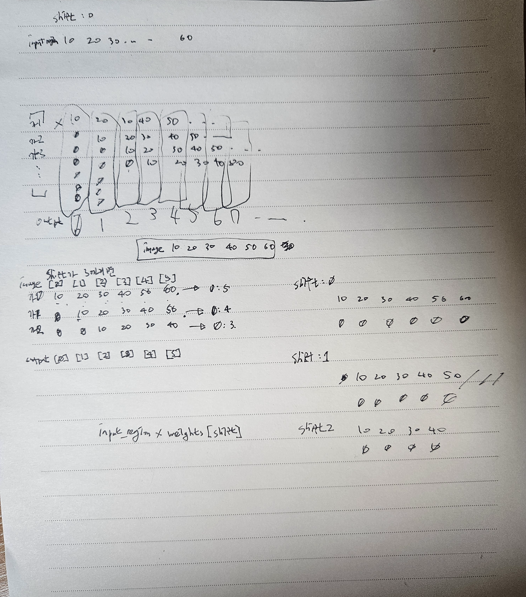

# 10월 31일 과제

- CNN 기초
- MNIST 평가 그래프 그리기
- MNIST 학습 모델 Feature Map확인
- MNIST GPU 학습
- CIFAR-10 GPU 학습 및 모델 저장/불러오기
- Bounding Box 좌표 변환 및 IoU 계산
- Confidence Thresholding 및 NMS 구현
- 잔상 효과 NumPy, CuPy 코딩
- Convolution 연산 NumPy, CuPy 코딩

## 파일 구조

```text
2026.11.01/
├── cnn_filter_assignment.py   # Smoothing/Sharpening CNN 필터 실습
├── mnist_cnn_assignment.py    # MNIST 학습, 평가 그래프, Feature Map 시각화
├── MNIST_main_gpu.py          # GPU 기반 MNIST 학습 및 평가
├── CIFAR10_main_gpu.py        # GPU 기반 CIFAR-10 학습 및 모델 저장/불러오기
├── CIFAR10_CNN.pth            # 학습이 완료된 CIFAR-10 모델 체크포인트
├── iou_assignment.py          # Bounding Box 좌표 변환 및 IoU 계산
├── nms_assignment.py          # Confidence Thresholding 및 NMS 구현
├── motion_trail_assignment.py # NumPy/CuPy 잔상 효과 및 속도 비교
├── convolution_assignment.py  # NumPy/CuPy Convolution 연산 및 속도 비교
└── README.md                  # 파일 설명, 실행 방법, 참고 사항
```

- **cnn_filter_assignment.py**: `../src/images/seagull.jpg`를 흑백으로 불러와, 수업에서 작성한 `convolution2d()`에 Smoothing/Sharpening 필터와 편향을 적용하는 코드. Convolution 결과와 ReLU Feature Map을 비교한다.
  - TODO는 Smoothing/Sharpening CNN의 구현임.
- **mnist_cnn_assignment.py**: `../src/datasets`의 MNIST를 불러와 수업 시간에 했던 것처럼 `SimpleCNN`을 3 epoch 학습한다. Train/Test loss와 accuracy를 그리고, 학습된 모델의 `conv1`, `relu1`, `pool1`, `conv2`, `relu2`, `pool2` Feature Map을 `viridis`로 출력한다. 학습된 가중치는 `../src/models/MNIST/MNIST_CNN.pth`에 저장한다.
  - TODO는 학습 후 에폭별 loss와 accuracy 그래프 그리는 코드와 학습된 모델의 Feature Map을 확인하는 코드이다.
- **MNIST_main_gpu.py**: `../src/datasets`의 MNIST를 불러와 `SimpleCNN`을 CUDA GPU에서 3 epoch 학습한다. Epoch마다 Train/Test loss와 accuracy, 학습 시간을 출력하고 전체 GPU 학습 시간을 확인한다.
  - TODO는 GPU 기반 MNIST 데이터셋 학습 코드이다.
- **CIFAR10_main_gpu.py**: `../src/datasets`의 CIFAR-10을 불러와 데이터 증강과 정규화를 적용하고, `ConvBlock` 3개로 구성한 `CIFAR10CNN`을 CUDA GPU에서 5 epoch 학습한다. GPU Warm-up 후 Epoch별 Train/Test loss와 accuracy, 학습 시간을 출력한다. 학습된 모델과 Optimizer 정보는 `../src/models/CIFAR10/CIFAR10_CNN.pth`에 저장하고 다시 불러와 모델 이름, Epoch, 마지막 테스트 정확도를 확인한다.
  - TODO는 CUDA GPU 장치에서 CIFAR-10 데이터셋을 학습하고 평가하며, 각 Epoch 및 전체 학습 시간을 출력하는 코드이다.
- **CIFAR10_CNN.pth**: `CIFAR10_main_gpu.py`로 5 epoch 학습한 `CIFAR10CNN` 체크포인트의 복사본이다. GitHub에서 학습 결과를 바로 확인하거나 재학습 없이 가중치를 불러올 수 있도록 과제 폴더에 함께 추가했다.
- **iou_assignment.py**: `(x, y, w, h)` 형식의 Bounding Box를 `(x1, y1, x2, y2)` 형식으로 변환하고, 두 Bounding Box의 교집합과 합집합 넓이를 사용하여 IoU를 계산한다. 겹치는 영역이 없으면 IoU는 0이며, 합집합 넓이가 0인 경우에도 `ZeroDivisionError`가 발생하지 않도록 0을 반환한다.
  - TODO는 Bounding Box 좌표 변환 함수와 IoU 계산 함수의 구현이다.
- **nms_assignment.py**: Confidence Score가 임계값보다 낮은 Bounding Box를 먼저 제거하고, 남은 Bounding Box를 Confidence Score가 높은 순서로 정렬한다. 가장 높은 점수의 Bounding Box와 다른 박스들의 IoU를 비교하여 중복 박스를 제거하는 NMS를 반복한다.
  - TODO는 Confidence Thresholding 함수와 `np.argsort()`를 사용한 NMS 함수의 구현이다.
- **motion_trail_assignment.py**: 같은 갈매기 이미지를 1280×720으로 바꾸고, 길이 32의 잔상을 NumPy 픽셀 반복과 CuPy 배열 슬라이싱으로 각각 계산한다. CPU/GPU 결과가 같은지도 확인하고 처리 시간을 비교한다.
  - TODO는 NumPy와 CuPy를 통해 적은 잔상효과 코드 구현 부분이다.
- **convolution_assignment.py**: 같은 갈매기 이미지에 x축/y축 edge filter를 적용한다. NumPy는 출력 픽셀을 하나씩 계산하고, CuPy는 kernel의 각 위치에 대응하는 이미지 전체 영역을 slicing하여 GPU에서 병렬 계산한다. CPU/GPU 결과가 같은지도 확인하고 처리 시간을 비교한다.
  - TODO는 CuPy를 사용한 2차원 convolution 함수, CPU/GPU 처리 과정, 결과 비교 및 출력 코드의 구현이다.

## 저장된 CIFAR-10 모델

`CIFAR10_CNN.pth`는 모델 구조 자체가 아니라 학습 결과와 메타데이터를 담은 PyTorch 체크포인트이다. 저장된 마지막 테스트 정확도는 **81.95%**이다.

체크포인트에는 다음 정보가 포함되어 있다.

- `model_state_dict`: 학습된 모델 가중치
- `optimizer_state_dict`: Optimizer 상태
- `model_name`, `epochs`, `test_accuracy`: 모델 및 학습 결과 정보
- `class_names`: CIFAR-10 클래스 이름
- `mean`, `std`: 학습과 추론에 사용한 정규화 값

모델을 불러올 때는 `CIFAR10_main_gpu.py`와 같은 `CIFAR10CNN` 구조를 먼저 생성한 뒤 `model_state_dict`를 적용해야 한다.

```python
checkpoint = torch.load("CIFAR10_CNN.pth", map_location="cpu", weights_only=True)
model = CIFAR10CNN()
model.load_state_dict(checkpoint["model_state_dict"])
model.eval()
```

`CIFAR10_main_gpu.py`를 다시 실행하면 학습된 모델은 `../src/models/CIFAR10/CIFAR10_CNN.pth`에 저장된다. 현재 과제 폴더의 `CIFAR10_CNN.pth`는 2026년 10월 31일 Jetson에서 학습하고 저장한 파일을 복사한 것이다.

<br>

## 실행 방식

현장 Jetson에 필요한 라이브러리와 CUDA/CuPy 환경이 준비되어 있다는 전제로 작성했다. 모든 데이터 경로를 과제 폴더 기준 상대 경로로 적었으므로 **먼저 과제 폴더로 이동한다.**

```bash
cd 2026.11.01
```

CNN Smoothing/Sharpening 필터:

```bash
python3 cnn_filter_assignment.py
```

MNIST CNN 학습, 평가 그래프, Feature Map 확인:

```bash
python3 mnist_cnn_assignment.py
```

MNIST CNN GPU 학습:

```bash
python3 MNIST_main_gpu.py
```

CIFAR-10 CNN GPU 학습 및 모델 저장/불러오기:

```bash
python3 CIFAR10_main_gpu.py
```

Bounding Box 좌표 변환 및 IoU 계산:

```bash
python3 iou_assignment.py
```

Confidence Thresholding 및 NMS 적용:

```bash
python3 nms_assignment.py
```

NumPy/CuPy 잔상 효과 및 속도 비교:

```bash
python3 motion_trail_assignment.py
```

NumPy/CuPy Convolution 연산 및 속도 비교:

```bash
python3 convolution_assignment.py
```

MNIST와 CIFAR-10은 `download=True`로 설정했다. `../src/datasets`에 데이터가 이미 있으면 그대로 읽고, 없을 때만 해당 위치로 내려받는다. 데이터셋 파일은 과제 폴더에 복사하지 않았다.

`MNIST_main_gpu.py`와 `CIFAR10_main_gpu.py`는 CUDA GPU를 사용하는 코드이다. `CIFAR10_CNN.pth`는 CIFAR-10 학습이 끝난 뒤 `../src/models/CIFAR10`에 생성된다.

`iou_assignment.py`는 별도의 외부 라이브러리 없이 실행할 수 있다. `nms_assignment.py`는 Confidence Score 정렬을 위해 NumPy를 사용한다.

`motion_trail_assignment.py`와 `convolution_assignment.py`는 CUDA GPU와 CuPy를 사용하는 코드이다.

<br>

## 기타 참고 사항

### CNN Smoothing/Sharpening

결과를 보니, Smoothing은 Sharpening과 다르게 ReLU를 하나 마나 똑같았다.

왜지...? 하고 보니.. Smoothing은 어처피 가우시안이든 박스 필터이든, 양수를 곱하기 때문이었다. ReLU는 음수만 없애고 양수는 그대로 뱉어내므로, Smoothing에는 큰 효과가 없음을 깨달았다.

하지만, Sharpening은 주변은 음수, 가운데만 양수, 커널의 합은 1로 만들기 때문에, 음수 처리가 있어, ReLU의 효과가 커서 차이가 큼을 볼 수 있었다.

### NumPy 잔상 효과에서 헷갈렸던 부분

CPU 코드는 출력 한 칸을 다음 식처럼 직접 계산한다.

```text
output[y, x] = image[y, x-0] × weight[0]
             + image[y, x-1] × weight[1]
             + ...
             + image[y, x-31] × weight[31]
```

`x-shift`가 음수가 되면 NumPy의 음수 index가 배열 뒤쪽을 읽어 버린다. 그러면 왼쪽 경계가 오른쪽 끝과 이어지는 이상한 결과가 생기므로 그 값은 반드시 0으로 처리했다.

그리고 처음에는 `input_array[shift] = 0`처럼 쓰려고 했는데, `input_array = []`는 길이가 0인 빈 리스트라 아직 그 index가 존재하지 않는다. 그래서 `append(0.0)` 또는 `append(weighted_pixel)`로 한 칸씩 추가해야 했다. 빈 리스트를 만들어 놓고 저장 공간이 이미 생겼다고 생각했던 부분이 헷갈렸다...ㅎㅎ

가중치 32개는 2차원 CNN kernel은 아니지만, x축 방향으로만 적용하는 1차원 filter라고 생각할 수 있다. 정확히는 현재 픽셀과 왼쪽의 과거 픽셀들을 가중합하는 FIR filter와 비슷한 형태다. 이미지의 세로 방향으로는 이동하지 않으므로 각 행에 같은 1차원 연산을 적용한다.

어쨌든 이 CPU 코드를 풀면서 수식이 다음과 같음을 알게 되었다.

$$
\text{output}[x,i] = \sum_{s=0}^{31} \text{image}[x,i-s] \times \text{weights}[s]
$$

이다..

근데, 병렬 연산이 되는 gpu는... 어떻게...??? 보니까 슬라이싱을 이용했었다. **슬라이싱**이 엄청난 힌트가 되었다!!

### CuPy 슬라이싱 설명

GPU에서는 출력 픽셀 하나씩 Python 반복문으로 계산하지 않고, `shift` 하나마다 이미지 전체 영역을 계산한다.

```python
input_region = image[:, :image_width - shift]
output_region = output[:, shift:]
output_region += input_region * weights[shift]
```

예를 들어 width가 5이고 `shift=2`라면 `input_region`은 원본의 0~2번째 열이고, `output_region`은 출력의 2~4번째 열이다. 두 영역의 shape가 같으므로 원본이 오른쪽으로 두 칸 이동한 위치에 더해진다. 출력의 왼쪽 두 칸은 처음 만든 0이 그대로 남아서 별도 padding 배열 없이도 zero padding이 된다.

`output_region`은 복사본이 아니라 `output`의 view이므로 `+=` 결과가 원래 output 배열에 바로 누적된다. 바깥의 `for shift`는 여전히 순차 실행되지만, 각 단계의 전체 픽셀 곱셈과 덧셈은 GPU에서 병렬 처리된다.

왼쪽 경계에서는 존재하지 않는 항을 0으로 두기 때문에 가중치 합이 1보다 작아진 것처럼 보여 조금 어두워질 수 있다. 경계에서만 남은 가중치를 다시 정규화하는 방법도 있지만, 그러면 zero padding을 사용한 원래 수식과 다른 효과가 된다. 이번 과제는 노트북 설명과 같은 zero padding 방식을 그대로 따랐다.

### 코드 검증 Output 생성

그림이 그럴듯하게 보이는 것만으로는 CPU/GPU 계산이 정말 같은지 알기 어려워서 작은 배열의 정답을 손으로 먼저 구했다.



```text
image   = [10, 20, 30, 40, 50]
weights = [0.6, 0.3, 0.1]
output  = [6, 15, 25, 35, 45]
```

이 값을 기준으로 NumPy 반복문과 배열 slicing의 계산 방향을 확인했다.

### CuPy Convolution에서 헷갈렸던 부분

CPU에서는 출력 픽셀을 기준으로 반복문을 돌면서 kernel 크기만큼 이미지를 잘라 가중합을 구했다. 그런데 GPU에서도 출력 픽셀을 하나씩 반복하면 Python 반복문이 너무 많아서 GPU를 사용하는 의미가 적어진다.

그래서 GPU 코드는 반대로 kernel의 위치를 기준으로 반복했다.

```python
input_region = padded_image[
    kernel_y:kernel_y + output_height * stride:stride,
    kernel_x:kernel_x + output_width * stride:stride
]
output += input_region * kernel[kernel_y, kernel_x]
```

예를 들어 `kernel_y=0`, `kernel_x=1`이면 모든 출력 위치에서 kernel의 `[0, 1]`과 만나는 입력 픽셀들을 한 번에 가져온다. 그리고 그 배열 전체에 `kernel[0, 1]`을 곱해서 output 전체에 누적한다.

처음에는 convolution이니까 무조건 출력 이미지의 y, x를 하나씩 돌아야 한다고 생각했는데, 계산 순서를 kernel 기준으로 바꾸면 kernel 크기만큼의 반복문만 Python에서 실행하고 이미지 전체 곱셈과 덧셈은 GPU에서 병렬 처리할 수 있었다.

또 GPU 시간은 비동기 연산 때문에 `time.perf_counter()`만 사용하면 실제 연산이 끝나기 전에 시간이 측정될 수 있다. 그래서 측정 전후에 `cp.cuda.Stream.null.synchronize()`를 넣었다. 처음 실행할 때 CUDA 초기화 시간이 포함되지 않도록 작은 이미지로 warm-up도 먼저 수행했다.
