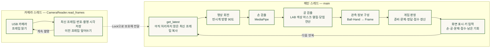
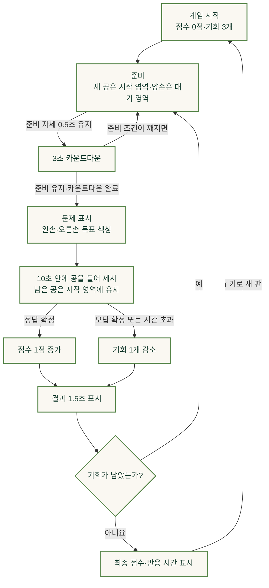

# 색깔 순발력 테스트

## 시연 영상

https://github.com/user-attachments/assets/cc26ebef-1728-44cd-9986-173833890266

## 파일 구조

```text
Project01/
├── README.md
├── main.py
├── vision.py
├── game.py
├── contracts.py
└── assets/
    └── fonts/
        ├── NotoSansKR-wght.ttf
        └── OFL.txt
```
- **README.md**: 프로젝트 개요와 설명
- **main.py**: 모델 준비, 최신 카메라 프레임 읽기, 회전, 손·공 관측, 화면 표시와 종료 정리
- **vision.py**: MediaPipe 결과를 `Hand`로 변환하고 LAB 마스크·외곽선에서 색별 `Ball` 후보와 오버레이 생성
- **game.py**: 한 프레임 판정, 문제 시작, `ACTIVE` 판정, 점수·재준비와 입력 장애 복구 처리
- **contracts.py**: 공·손·프레임 정보를 담는 `Ball`, `Hand`, `Frame` 일반 클래스
- **assets/**: 게임 화면에 사용하는 리소스를 보관하는 폴더
- **assets/fonts/**: 게임 화면의 한글 출력을 위한 폰트와 라이선스를 보관하는 폴더
- **assets/fonts/NotoSansKR-wght.ttf**: 점수, 안내 문구, 게임 상태 등의 한글 표시에 사용하는 Noto Sans KR 폰트
- **assets/fonts/OFL.txt**: Noto Sans KR 폰트의 SIL Open Font License 1.1 원문

<br>

## 실행 방식

아래에서 **프로젝트 루트 디렉토리**는 `[Project01]`, `.venv`, `src` 폴더를 두는 최상위 디렉토리를 뜻한다. 터미널에서 해당 디렉토리로 이동한 상태를 기준으로 명령을 실행한다.

### 가상환경 구축

[00_Initial-Setup.ipynb](../lecture_ipynb_files/00_Initial-Setup.ipynb)의 `--system-site-packages` 방식으로 가상환경을 만들고, [02_Computer-Vision.ipynb](../lecture_ipynb_files/02_Computer-Vision.ipynb)의 MediaPipe 설치 방식을 사용한다. 아래는 Project01에 필요한 구성만 정리한 것이다. 이미 준비된 `.venv`가 있다면 다시 만들지 않고 `source .venv/bin/activate`로 활성화한다.

프로젝트 루트 디렉토리에서 실행한다.

```bash
sudo apt update
sudo apt install -y python3-venv python3-opencv python3-matplotlib libportaudio2 \
    v4l-utils gstreamer1.0-tools gstreamer1.0-plugins-good wget
python3 -m venv --system-site-packages .venv
source .venv/bin/activate

python -m pip install "numpy==1.23.0" "Pillow==10.4.0"
python -m pip install --no-deps "mediapipe==1.1.1"
python -m pip install "absl-py==2.5.1" "flatbuffers==25.12.19" "sounddevice==0.5.6" "certifi==2026.7.22"
```

MediaPipe를 `--no-deps`로 설치하는 것은 노트북의 방식이다. 카메라 입력에 필요한 GStreamer 지원을 유지하도록 OpenCV는 시스템 패키지를 사용하고, 가상환경에서 이를 참조한다. `matplotlib`, `certifi`, `sounddevice`도 MediaPipe의 의존성이다. `sounddevice`와 PortAudio는 게임에 음성 기능을 추가하기 위한 설치가 아니다.

2026년 11월 8일 SSH로 확인한 Jetson 환경은 다음과 같다. 아래 패키지 버전은 해당 장치에서 확인한 값이며, 새 가상환경을 만들어 설치하는 과정 전체를 다시 검증한 것은 아니다.

| 항목 | 확인한 구성 |
| --- | --- |
| 장치 | NVIDIA Jetson Orin Nano Engineering Reference Developer Kit Super |
| 운영체제·아키텍처 | Ubuntu 22.04.5 LTS · aarch64 |
| Jetson Linux L4T | 36.5.2 (`nvidia-l4t-core`: `36.5.2-20260716114719`) |
| Python | 3.10.12 |
| 가상환경 | `include-system-site-packages = true` |
| OpenCV | 4.5.4 · 시스템 패키지 사용 · GStreamer YES (1.19.90) · GTK3 |
| NumPy / Pillow | 1.23.0 / 10.4.0 |
| MediaPipe | 1.1.1 |
| MediaPipe 관련 의존성 | absl-py 2.5.1 · flatbuffers 25.12.19 · sounddevice 0.5.6 · certifi 2026.7.22 · matplotlib 3.5.1 (시스템 패키지) |

이 구성에서 OpenCV·NumPy·MediaPipe·Pillow 임포트와 `HandLandmarker` 생성까지 확인했다. USB 카메라와 화면 출력은 아래 실행 명령으로 장치에서 확인해야 한다.

### 모델 준비

손 검출에는 [02_Computer-Vision.ipynb](../lecture_ipynb_files/02_Computer-Vision.ipynb)의 MediaPipe 실습에서 사용한 **Hand Landmarker** 모델을 사용한다. `vision.py`는 이 모델로 최대 두 손의 랜드마크와 왼손·오른손 분류 결과를 얻는다.

| 용도 | 필요한 파일 | 저장 위치 (프로젝트 루트 디렉토리 기준) |
| --- | --- | --- |
| 양손 검출 | `hand_landmarker.task` | `src/models/MediaPipe/hand_landmarker.task` |

노트북의 다운로드 명령을 따라 다음과 같이 준비한다. 이미 같은 모델 파일이 있다면 다시 다운로드하지 않아도 된다.

```bash
# 프로젝트 루트 디렉토리에서 실행
mkdir -p src/models/MediaPipe
wget https://storage.googleapis.com/mediapipe-models/hand_landmarker/hand_landmarker/float16/latest/hand_landmarker.task \
    -O src/models/MediaPipe/hand_landmarker.task
```

프로젝트와 모델은 다음 위치에 둔다.

```text
프로젝트 루트 디렉토리/
├── .venv/
├── src/models/MediaPipe/
│   └── hand_landmarker.task
└── [Project01]/
    ├── main.py
    ├── vision.py
    └── ...
```

`vision.py`의 모델 경로는 `../src/models/MediaPipe/hand_landmarker.task`이며 실행 디렉토리를 기준으로 찾는다. 따라서 아래 실행 명령처럼 `[Project01]` 폴더로 이동한 뒤 실행해야 한다. 모델은 프로그램에서 자동으로 다운로드하지 않는다.

공 검출은 LAB 색상 마스크와 모폴로지 연산을 사용하므로 별도의 학습 모델이 필요하지 않다. 같은 노트북에서 함께 다운로드하는 `pose_landmarker_full.task`는 이 프로젝트에서 사용하지 않는다. 한글 표시에 필요한 폰트는 저장소의 `assets/fonts/`에 포함되어 있다.

### 실행 환경

Jetson의 프로젝트 루트 디렉토리에 위 가상환경과 모델을 준비하고, 가천대학교에서 제공하는 USB 카메라를 연결한다.

USB 카메라는 `main.py`의 `/dev/video0` GStreamer 파이프라인으로 열기 때문에, OpenCV에서 GStreamer와 화면 출력 기능을 사용할 수 있어야 한다. Jetson의 화면이 연결된 그래픽 세션에서 실행한다.

```bash
# 프로젝트 루트 디렉토리에서 실행
source .venv/bin/activate
cd '[Project01]'
python main.py
```

게임 창에서 `q`를 누르면 종료된다. 프로그램을 다시 실행하려면 같은 명령을 입력하면 된다.

### 카메라·화면 설정

| 항목 | 코드의 설정 |
| --- | --- |
| USB 카메라 | `/dev/video0` |
| 입력 형식 | YUY2 · 640 × 480 · 30 FPS 요청 |
| 영상 변환 | GStreamer에서 BGR 변환 후, 프로그램에서 반시계 방향 90도 회전 |
| 화면 출력 | OpenCV 창과 한글 폰트 사용 · 그래픽 세션 필요 |
| 손의 좌우 구분 | `main.py`의 `HAND_MAPPING` · 화면 위치가 아니라 실제 왼손·오른손 기준 |

USB 카메라를 연결한 뒤 다음 명령으로 장치와 지원 형식을 확인한다. 30 FPS는 코드에서 요청하는 값이며 실제 처리 속도를 뜻하지 않는다.

```bash
v4l2-ctl --list-devices
v4l2-ctl --device=/dev/video0 --list-formats-ext
gst-inspect-1.0 v4l2src
gst-inspect-1.0 videoconvert
gst-inspect-1.0 appsink
```

카메라 번호나 지원 형식이 다르면 `main.py`의 `CAMERA_PIPELINE`을 장치에 맞춰 바꾼다. 회전한 화면에서 영역 좌표 `REGIONS`와 `HAND_MAPPING`도 확인한다. SSH 터미널만으로는 게임 창이 표시되지 않을 수 있으므로 Jetson의 데스크톱 터미널에서 실행한다. 2026년 11월 8일 SSH 점검 당시에는 `/dev/video0` 장치가 없어 실제 촬영·화면 출력은 재검증하지 않았다.

### 처리 과정

카메라 촬영은 `CameraReader`의 별도 스레드에서 계속 수행하고, 손·공 판독과 게임 진행·화면 출력은 메인 스레드에서 순서대로 처리한다.



촬영 스레드는 손·공 판독이나 게임 판정을 하지 않는다. 메인 스레드가 판독하는 동안에도 촬영을 이어가며, 프레임을 대기열에 쌓는 대신 최신 한 장을 갱신한다. 공유 데이터는 `threading.Lock`으로 보호하고, 메인 스레드는 복사본을 받아 사용한다. 따라서 처리 속도보다 촬영이 빠르면 중간 프레임은 건너뛴다. 손 검출·공 검출·게임 판정은 모두 같은 메인 스레드에서 순서대로 실행한다.

새 프레임이 없을 때도 메인 반복문은 입력 공백 확인, 확정 결과의 표시 시간 갱신, 화면 출력과 키 입력 처리를 이어간다.

`main.py`의 메인 스레드는 다음 순서로 동작한다.

1. 카메라 스레드가 저장한 최신 프레임을 복사해 가져온다.
2. 프레임을 반시계 방향으로 90도 회전한다.
    - 게임 화면이 세로 이기 때문에. 위 아래가 안 맞으면 카메라를 직접 돌려서 맞춰야 한다...
3. MediaPipe로 양손을 검출한다.
4. LAB 색 공간에서 빨강·초록·파랑 공을 검출한다.
5. 손과 공의 위치를 게임 규칙에 전달한다.
6. 점수, 남은 기회, 문제와 안내 문구를 화면에 표시한다.

현재 카메라 화면의 영역은 다음과 같이 설정되어 있다.

```python
REGIONS = {
    "start": (0.02, 0.00, 0.98, 0.30),
    "presentation": (0.02, 0.31, 0.98, 0.62),
    "waiting": (0.02, 0.63, 0.98, 1.00),
}
```

- `start`: 사용하지 않는 공을 두는 시작 영역
- `presentation`: 선택한 공을 손에 들고 보여 주는 영역
- `waiting`: 게임 시작 전 양손을 준비하는 영역

다음 좌표는 현장에서 직접 카메라 고정대를 만들고 좌표값을 정했다...

### 색상 검출과 모폴로지 연산

공 검출에는 LAB 색 공간을 사용한다. 코드에서 했던 것보다.. 마스크 검출이 잘 안되어서 젯슨에 연결된 카메라로 탁구공을 찍은 후에 스샷을 ssh를 통해 컴퓨터로 보내고 AI한테 색 보정을 시켰다..

```python
BALL_LAB_RANGES = {
    "red": ((35, 150, 130), (200, 230, 220)),
    "green": ((30, 60, 90), (230, 115, 180)),
    "blue": ((20, 145, 40), (220, 175, 115)),
}
```

색상 마스크에는 `5×5` 타원형 커널을 사용해 열림 연산 후 닫힘 연산을 적용한다.

```python
kernel = cv2.getStructuringElement(cv2.MORPH_ELLIPSE, (5, 5))
```

열림 연산은 공 주변의 작은 점 잡음을 제거하고, 닫힘 연산은 공 내부의 작은 빈 공간을 메운다. `SHOW_MASKS = True`로 바꾸면 색상별 원본 마스크와 처리된 마스크를 비교할 수 있다. 게임을 실행할 때는 `SHOW_MASKS = False`로 설정한다.

한글 안내 문구는 `assets/fonts/NotoSansKR-wght.ttf`를 사용하며, 폰트 라이선스는 `assets/fonts/OFL.txt`에 포함되어 있다.

<br>

## 창의성 및 확장성

### 주제 선정 이유

유튜브를 보다가 노인 복지 센터나 노양원에서 노인의 치매 예방과 뇌 인지 활성화를 위해 색깔 반응 놀이(일명, "실버 운동"이라고 한다고 한다.)를 한다는 것을 보았다.

https://youtube.com/shorts/TE9CqG90bhc?si=qtkluPr6HMFVK1-G

그래서, 나는 이번 프로젝트로 색깔 공을 통해 순발력있게 공을 짚는 순발력 게임을 만들었다. 그래서 공의 색을 구별하고, 왼손과 오른손에 들어야 할 공을 기억한 뒤, 제한 시간 안에 움직이는 과정을 하나의 게임으로 만들었다.

### 아이디어 설명

탁자 위에는 빨강·초록·파랑 탁구공과 공을 올려놓을 컵 3개를 배치한다. 카메라는 탁자 전체와 양손이 보이도록 고정한다. 게임 화면에 왼손과 오른손이 들어야 할 공의 색이 제시되면, 사용자는 해당 공을 집어 양손에 하나씩 들고 중앙의 제시 영역으로 옮긴다.

선택하지 않은 세 번째 공은 시작 영역에 남아 있어야 한다. 두 손의 공만 맞는 것이 아니라 남은 공의 위치까지 함께 확인하므로, 공을 아무 곳에 놓거나 잘못 옮긴 경우를 구분할 수 있다.

게임은 다음 순서로 진행된다.



정답·오답은 같은 판정이 0.4초 이상, 최소 4프레임 동안 유지될 때 확정한다. 판정할 자세가 갖춰지지 않으면 제한 시간 안에서 계속 기다린다. `r` 키로 언제든 새 판을 시작하고, `q` 키로 프로그램을 종료할 수 있다.

게임 상태는 `game.py`의 `game_state["status"]`로 관리한다. 위 흐름도를 코드의 상태 이름으로 정리하면 다음과 같다.

| 상태 | 역할 | 다음 상태로 넘어가는 조건 |
| --- | --- | --- |
| `SETUP` | 설정된 영역과 첫 정상 관측을 기다린다. | 정상 프레임과 영역 정보가 들어오면 `READY`로 이동한다. |
| `READY` | 세 공이 시작 영역에 있고 양손이 대기 영역에 있는지 확인한다. | 준비 자세가 0.5초 유지되면 `COUNTDOWN`으로 이동한다. |
| `COUNTDOWN` | 준비 자세를 유지하며 3초를 센다. | 준비 조건이 깨지면 `READY`로 돌아간다. 카운트다운 완료 후 문제를 화면에 표시하면 `ACTIVE`로 이동한다. |
| `ACTIVE` | 문제 표시 시점부터 10초 동안 손·공의 위치와 목표 색상을 판정한다. | 정답 확정 시 `RESULT_SUCCESS`, 오답 확정 시 `RESULT_WRONG`, 제한 시간 초과 시 `RESULT_TIMEOUT`으로 이동한다. |
| `RESULT_SUCCESS` | 점수 1점을 더하고 성공 반응 시간을 기록한다. | 결과를 1.5초 표시한 뒤 남은 기회에 따라 `RESET` 또는 `SUMMARY`로 이동한다. |
| `RESULT_WRONG` | 기회를 1개 줄이고 오답 이유를 표시한다. | 결과를 1.5초 표시한 뒤 기회가 남으면 `RESET`, 없으면 `SUMMARY`로 이동한다. |
| `RESULT_TIMEOUT` | 기회를 1개 줄이고 시간 초과를 표시한다. | 결과를 1.5초 표시한 뒤 기회가 남으면 `RESET`, 없으면 `SUMMARY`로 이동한다. |
| `RESET` | 끝난 라운드의 문제·타이머·판정 기록을 정리한다. | 다음 갱신에서 `READY`로 이동한다. 점수와 남은 기회는 유지한다. |
| `PAUSED` | 입력 장애 복구를 기다린다. 점수와 기회는 차감하지 않는다. | 정상 입력이 돌아오면 초기 설정 중이었던 경우 `SETUP`, 그 외에는 `READY`로 돌아간다. 진행 중이던 미완료 문제는 무효 처리한다. |
| `SUMMARY` | 최종 점수·시도 수·성공 반응 시간의 평균과 최단 기록을 표시한다. | `r` 키를 누르면 점수와 기회를 초기화하고 `SETUP`부터 새 판을 시작한다. |

정상 입력이 0.5초 이상 끊기거나 모델 처리 오류가 발생하면 `PAUSED`로 이동한다. 0.35초를 넘는 입력 공백이나 카메라 읽기 실패만으로도 준비·판정의 연속 기록은 초기화된다. 이미 확정된 결과와 `SUMMARY` 화면은 입력 장애가 생겨도 유지한다. 결과 표시가 끝난 뒤에도 장애가 이어지고 다음 라운드가 남아 있으면 `PAUSED`에서 복구를 기다린다.

1. 세 공을 시작 영역에 놓고 양손을 대기 영역에 둔다.
2. 준비 상태가 유지되면 3초 카운트다운이 시작된다.
3. 화면에 왼손과 오른손의 목표 색상이 표시된다.
4. 사용자는 제한 시간 안에 알맞은 공을 양손에 들어 제시 영역으로 옮긴다.
5. 정답이면 점수가 1점 올라가고, 오답이나 시간 초과이면 기회가 1개 줄어든다.
6. 공과 손을 준비 위치로 되돌리면 다음 문제가 시작된다.

### 준비·정답·오답 판정 기준

`game.py`의 `inspect_frame()`은 한 프레임의 자세를 확인하고, `update_preparation()`과 `update_active()`는 그 자세가 필요한 시간 동안 이어지는지 확인한다. 영역 안에 있는지는 공의 중심과 손바닥 중심 좌표를 기준으로 판단한다.

| 구분 | 판정 조건 | 처리 |
| --- | --- | --- |
| 관측 유효성 | 빨강·초록·파랑마다 실제로 검출되고 신뢰 가능하다고 표시된 공 후보가 정확히 1개씩 있어야 한다. 보정된 실제 왼손·오른손도 각각 1개씩 검출되고 손 분류 점수가 0.70 이상이어야 한다. | 조건이 부족하면 준비 완료나 정답·오답으로 판정하지 않는다. 예측 위치는 채점에 사용하지 않는다. |
| 준비 자세 | 세 공의 중심이 모두 시작 영역에 있고, 양손의 손바닥 중심은 대기 영역에 있어야 한다. 제시 영역에는 관측된 공의 중심이나 손바닥 중심이 없어야 한다. | 0.5초 유지하면 카운트다운을 시작하며, 카운트다운 중에도 준비 자세를 유지해야 한다. |
| 채점 가능한 자세 | 양손의 손바닥 중심이 제시 영역에 있고, 각 손에 공이 하나씩 연결되어야 한다. 공은 중심이 제시 영역과 해당 손의 손바닥 상자 안에 있을 때 그 손의 공으로 본다. | 양손의 공을 구분할 수 있으면 목표 색상과 남은 공의 위치를 확인한다. |
| 정답 후보 | 왼손·오른손의 공 색상이 문제의 순서와 일치하고, 선택하지 않은 세 번째 공은 시작 영역에 있어야 한다. | `correct`로 판정한다. 같은 판정이 0.4초 이상·최소 4프레임 유지되면 정답으로 확정하고 1점을 더한다. |
| 오답 후보 | 채점 가능한 자세에서 손별 목표 색상이 다르거나 남은 공이 시작 영역 밖에 있다. | `wrong`으로 판정한다. 같은 판정이 0.4초 이상·최소 4프레임 유지되면 오답으로 확정하고 기회를 1개 줄인다. |
| 판정 보류 | 공·손이 충분히 확인되지 않거나, 양손이 제시 영역에 없거나, 한 손의 공이 없거나 여러 개이거나, 공 하나가 양손의 손바닥 상자에 동시에 들어간다. | `hold`로 두고 안내 문구를 표시한다. 진행 중인 연속 판정 기록은 초기화하며 제한 시간 안에서 다시 기다린다. |
| 시간 초과 | 문제 표시 후 10초 안에 정답 또는 오답이 확정되지 않는다. | 시간 초과로 처리하고 기회를 1개 줄인다. 제한 시각에 정확히 확정된 정답·오답은 인정한다. |

공이 손에 들려 있는지는 영상에서 공 중심과 손바닥 상자가 겹치는지로 추정한다. 실제 접촉이나 물리적으로 공을 쥐었는지까지 확인하는 것은 아니다.

### 주요 설정값

다음 값은 `game.py`에 정의되어 있다. 시간과 프레임 수 조건은 함께 적용하며, 판정 유지 시간만 채웠다고 바로 정답·오답이 확정되지는 않는다.

| 설정 이름 | 현재 값 | 의미 |
| --- | --- | --- |
| `MIN_HAND_CONFIDENCE` | 0.70 | 왼손·오른손 분류 결과를 사용할 최소 점수 |
| `READY_DURATION` | 0.5초 | 카운트다운 전 준비 자세 유지 시간 |
| `COUNTDOWN_DURATION` | 3초 | 문제 표시 전 카운트다운 시간 |
| `ACTIVE_TIME_LIMIT` | 10초 | 문제 표시 후 정답·오답을 확정해야 하는 제한 시간 |
| `JUDGMENT_DURATION` | 0.4초 | 같은 정답·오답 판정을 유지해야 하는 최소 시간 |
| `MIN_JUDGMENT_FRAMES` | 4프레임 | 같은 정답·오답 판정을 확인해야 하는 최소 프레임 수 |
| `MAX_READY_GAP` | 0.35초 | 준비·판정의 연속성을 인정하는 최대 관측 간격. 초과하면 연속 기록을 초기화한다. |
| `STARTING_CHANCES` | 3개 | 새 판을 시작할 때 주는 기회 |
| `RESULT_DISPLAY_DURATION` | 1.5초 | 확정 결과를 표시하는 시간 |
| `INPUT_PAUSE_DURATION` | 0.5초 | 정상 입력 공백으로 일시 정지하기까지의 시간. 모델 처리 오류는 즉시 일시 정지한다. |

### 반응 시간의 측정 기준

성공한 문제의 반응 시간은 `judgment_started_at - problem_presented_at`으로 계산한다. 문제 표시 시점부터, 나중에 정답으로 확정된 연속 관측의 첫 정답 판독 완료 시점까지의 시간이다. 정답 유지 여부를 확인하는 이후의 대기 시간은 더하지 않는다.

예를 들어 문제 표시가 10.0초, 첫 정답 판독이 10.2초이고 이후 시간·프레임 조건을 만족해 정답이 확정되면 반응 시간은 0.2초로 기록한다. 이 값에는 카메라 입력과 영상 처리 지연이 영향을 주므로 사람의 순수한 반응 속도와 같지는 않다. 최종 화면의 평균·최단 반응 시간은 성공한 문제의 기록만 사용한다.

### 창의적인 요소

일반적으로 노인의 반응 운동에는 생각보다 노인의 격렬한 활동이 필요해진다. 그래서, 주로 아직 활발히 활동할 수 있는 노인만 가능하다. 하지만, 노인 중 많은 분들이 몸이 성하지가 않다. 특히, 뇌졸증이나 뇌출혈, 파키슨과 같이 뇌 질환이 있는 경우에는 더욱 불가능하다.

또한, 노인지도사가 직접 노인과 1대1로 함께해야 한다. 노인이 점점 많아지는 고령화 시대에 노인에게 1대1로 강사를 맞춰주기란 인력이 부족하다. 그래서, 이를 컴퓨터 비전을 통해 게임으로 만들어 몸이 안 좋아 움직임이 약하더라도 손만 움직여 색깔 반응 놀이를 할 수 있도록, 그리고 한 사람이 많은 노인을 더 쉽게 관리할 수 있도록 게임 프로그램을 만들었다.

나는 이게 창의적이라고 생각한다...

### 구현한 내용

- `main.py`: 카메라 입력, 화면 회전, 손·공 검출, 게임 진행과 화면 출력을 연결한다.
- `vision.py`: MediaPipe 손 검출과 LAB 색상 기반 공 검출을 수행한다.
- `game.py`: 준비, 카운트다운, 문제 출제, 정답·오답·시간 초과, 점수와 기회를 관리한다.
- `contracts.py`: 공, 손, 프레임 정보를 여러 모듈에서 공통으로 사용할 수 있게 정리한다.

현장에서는 카메라 위치를 고정한 뒤 세 영역의 좌표와 색상 범위를 조정했다. 빨강과 파랑 주변의 큰 물체가 공으로 잘못 인식되는 문제를 줄이기 위해 LAB 범위를 수정했고, `5×5` 타원형 커널을 이용한 열림·닫힘 연산을 적용했다. 이후 실제 공과 양손을 사용해 준비, 카운트다운, 문제 출제와 점수 처리가 이어지는 것을 확인했다.

### 확장성

현재는 코드의 제한 시간 등을 직접 바꿔 난이도를 조절할 수 있다. 움직임이 느린 사용자에게는 시간을 늘리고, 빠른 사용자에게는 시간을 줄일 수 있다. 이후에는 다음과 같은 방향으로 확장할 수 있을 것 같다.

- **사용자별 난이도:** 한 손만 사용하는 모드, 공의 색상 수 조절, 시간제한 없는 연습 모드를 추가하면 사용자의 움직임과 익숙한 정도에 맞춰 참여할 수 있을 것이다.
- **인지 활동의 다양화:** 목표 색상을 잠깐 보여 준 뒤 가리는 기억 모드나, 제시한 색상 순서대로 공을 드는 순서 기억 모드를 추가하면 색상 구분과 기억을 함께 사용하는 놀이로 확장할 수 있을 것이다.
- **접근성 개선:** 큰 글씨, 음성 안내, 색상과 도형을 함께 표시하는 방식을 추가하면 화면을 읽거나 색상을 구분하기 어려운 사용자도 참여하기 편해질 것이다.
- **복지관·주간보호센터 활용:** 여러 사람이 차례로 참여하고, 진행자가 코드를 수정하지 않고 화면에서 난이도를 쉽게 바꿀 수 있도록 확장할 수 있을 것이다.
- **개인별 활동 기록:** 성공률과 반응 시간의 변화를 저장하고 보여 주면 사용자가 자신의 게임 수행 기록을 살펴보는 데 도움이 될 것이다. 다만, 이 기록으로 치매 여부를 판단하거나 현재 게임에 치매 예방 효과가 있다고 단정할 수는 없다.

위 항목은 현재 구현된 기능이 아니라 앞으로의 확장 아이디어다.

<br>

## 기타 참고 사항

### 작업 중 경험한 문제점

#### 파란색, 빨간색 마스크 문제
현장에서 파란색 공과 빨간색 공 마스크가 잘 안되는 것을 확인했다... 난감했다. LAB 색공간에서는 잘 맞게 했는데... 파란색은 자꾸만 회색도 잡고, 빨간색은 근처에 빨간색 큰 네모난 것에 자꾸만 공이 있다고 표시해두었다.

그래서, 하는 수 없이 젯슨의 화면을 스크린샷 찍고 AI한테 mask를 위한 Range를 맞추어 달라고 하였다.

그 후에는 문제가 다행히 없는 것을 볼 수 있었다.

#### 카메라의 전송 시간 문제

처음 코드를 작성했을 때, 0.15초 동안 입력이 없으면 입력에 문제가 생겨 정답이나 준비를 계속 초기화 시켰다.

하지만, 현장에서 보니 0.15초로 하니 무한 준비 상태가 된 것을 볼 수 있었다.

내 생각보다.. 카메라 초가 더 느린 것 같아. 0.2초, 0.25초 0.3초 0.35초 씩 늘려 나갔다. 0.35초로 두었더니 잘 동작하는 것을 볼 수 있었다. 그래서, 0.35초로 두어 문제를 해결하였다.

#### AI활요 vs 본인 기여도

먼저, 코드는 당연히 AI와 함께 짰다.

먼저 Ball, Hand, Frame은 객체로 두는 것이 좋아 보여 Python에서 예전에 배웠던 객체 지향 프로그래밍 부분의 교재를 참고하여 AI와 함께 작성하였다.

AI가 해당 class들은 공통 class로 두는 것이 좋다고 하여 프로젝트 루트 디렉토리의 `contracts.py`로 두었다.

나머지, 코드도 AI를 활용하여 작성하였다. 솔직히 많이 활용하였다. 하지만, AI가 짜 준 코드를 한 줄 한 줄 읽어보며 이해하였고, 가독성이 좋지 않은 부분(예를 들어, if문의 순서가 코드 가독성에 좋지 않은 형태로 꼬여 있을 때)을 코드를 위에서 아래로 읽을 때 이해하기 쉽도록 고쳐나갔다.
