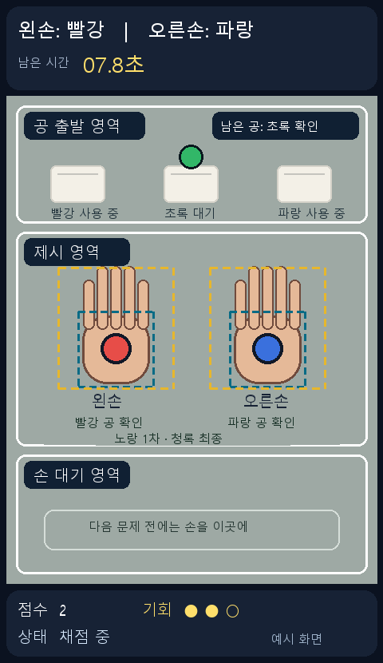

# 프로젝트 기획서 — Jetson 컬러 볼 리액션 챌린지

상태: 기획 수정안 · 2026-10-21. 카메라 없이 시작할 코드 경로와 현장 검증 항목을 분리했다. 실제 장비 시험 전이다.

## 한 문장 목표

Jetson에 연결한 카메라의 실시간 영상에서 **각 손과 색깔 공의 관계**를 판정하여, 화면이 요구한 색의 공을 왼손과 오른손에 올바르게 보여주기까지 걸린 시간과 성공 횟수를 기록하는 게임을 만든다.

## 사용자에게 보이는 한 판

1. 카메라 화면에 출발 영역과 제시 영역이 표시된다.
2. 공과 제시 영역이 준비되면 화면이 `왼손: 초록 / 오른손: 빨강`처럼 무작위 문제를 제시한다.
3. 사용자는 종이컵 위의 공을 골라 카메라 중앙의 제시 영역에서 양손에 해당 색 공을 하나씩 보여준다. 손바닥을 살짝 오므려도 되며 손가락을 모두 펼 필요는 없다. 공과 양손의 위치가 영상에 보여 어느 손의 공인지 구분되어야 한다. 영상 판정은 손 영역과 공의 관계를 확인하며 **물리적 접촉 자체를 증명하지는 못한다.**
4. 화면에는 손 레이블, 공의 실제 검출 위치, 손에 가려진 직후의 짧은 예측 위치, 손별 정오 피드백, 경과 시간이 나온다. 오래 가려지거나 화면 밖으로 나간 공은 위치를 안다고 표시하지 않는다.
5. 두 손에 제시된 공의 색과 소유 손이 확인되고, **문제에 선택되지 않은 세 번째 공이 출발 영역에 실제로 보이면** 1점을 얻고 반응 시간을 기록한다. 완성된 제시 자세에서 색 오답이나 남은 공의 출발 영역 이탈이 안정적으로 확인되거나 시간이 초과되면 기회가 1개 줄어든다. 기회 3개가 모두 소진되면 한 판이 끝난다.

## 기본 범위와 의도적 제한

| 구분 | 첫 완성 목표 |
| --- | --- |
| 입력 | 위에서 아래를 촬영하는 고정 USB 카메라 1대, 사람 1명, 두 손. Jetson Orin Nano로 추정하나 모델 미확인 |
| 공 | 빨강·초록·파랑 탁구공 각 1개. 빨강·파랑은 물감으로 준비할 예정이고 초록은 강사에게 요청할 예정 |
| 문제 | 서로 다른 두 색을 왼손·오른손에 한 개씩 지정 |
| 판정 | 손가락 모양과 관계없이, 왼손·오른손의 큰 손 상자로 공 근접성을 1차 확인하고 작은 손바닥 상자로 최종 확인한다. 지정 색 공의 실제 검출 중심이 각 손의 두 상자에 하나씩 있고, **남은 한 색 공도 출발 영역에 실제로 보이는** 장면을 기준으로 판정 |
| 게임 | 기회 3개로 시작. 성공 +1점, 안정적으로 확인된 오답 또는 시간 초과 시 기회 -1. 점수·기회·상태는 화면 하단에 표시 |
| 보류 | 같은 색 공 2개 이상, 2인 플레이, 추가 손동작 명령, 온라인 순위표 |

기본 범위의 수치와 색상은 하드코딩된 사실이 아니라 **초기 설계값**이다. 카메라·공 실물 시험을 통해 바꿀 수 있으며 모든 변경은 `GAME_RULES.md`와 설정 파일에 함께 반영한다.

## 촬영 배치와 준비물

카메라는 탁자 위에서 아래로 고정한다. 원본 640×480 영상에서는 왼쪽에 뒤집은 종이컵 3개와 공(출발 영역), 가운데에 두 손을 제시하는 빈 공간(제시 영역), 오른쪽에 손 대기 공간을 둔다. 카메라 프레임을 읽은 직후 `cv2.ROTATE_90_CLOCKWISE`로 회전하면 영상은 480×640의 세로형이 되고, 세 영역은 화면 위→중앙→아래 순서로 보인다. 공·손 인식과 영역 판정은 모두 회전된 영상의 좌표로 수행한다. 정보 띠를 위아래에 더하면 최종 창 높이는 640픽셀보다 커진다. 세 구역의 경계와 실제 좌표는 현장에서 보정한다.

사용자 계획은 **같은 높이의 신발 상자 2개**를 세우고 각각 안쪽 바닥에 500 mL 생수병을 넣은 뒤, 위에 **나무젓가락 2개를 가로로 고정**해 작은 USB 카메라의 렌즈가 아래를 향하게 두는 방식이다. 아직 조립·안정성 시험이 완료됐다고 확인되지 않았다. 젓가락 양 끝과 카메라 본체를 각각 상자에 단단히 고정하고, 렌즈 아래 시야를 가리지 않으며, USB 선이 카메라를 잡아당기지 않게 상자 쪽에 여유 있게 묶는다. 카메라가 가볍더라도 상자 기울어짐·가로대 처짐·낙하 위험은 별도로 확인한다. Jetson은 거치대 오른쪽의 단단하고 평평한 책상 면에 두고 냉각부 주변 공간과 전원선 여유를 확보한다. USB 선 길이는 실제 배치에서 확인한다.

공은 색마다 하나씩 충분히 넓고 균일하게 칠하되, 손·컵·배경과 잘 구별되는지 촬영 화면에서 확인한다. 종이컵은 굴러가지 않게 고정하고 손 제시 영역과 충분히 떨어뜨려 오검출을 줄인다.

## 화면 출력 방식

`2026.10.18/mp_hand.py`는 손 랜드마크를 카메라 프레임에 그린 뒤 `cv2.imshow()` 창 하나에 표시한다. 프로젝트에서는 같은 흐름을 확장한다. 매 프레임을 시계방향 90° 회전하고 그 영상에 손·공·세 영역을 그린다. 영상과 **같은 너비**의 위쪽 문제·시간 띠와 아래쪽 점수·기회·상태 띠를 따로 만든다. 띠의 한글은 Pillow와 프로젝트에 포함할 한글 폰트로 그린다. 세 이미지를 세로로 합친 **한 장의 화면**을 `cv2.imshow()`에 넘긴다. 창을 세 개 띄우는 방식은 아니다. 영상 크기는 첫 시험 설정에서 480×640이고, 최종 창 높이는 두 띠의 높이만큼 더 커진다.

이 그림은 실제 카메라 출력이나 구현 완료 화면이 아닌 **배치 목업**이다. 양손의 노란 점선은 손 전체의 1차 후보 상자, 청록 점선은 작은 손바닥 최종 판정 상자다. Jetson에서 폰트·창 크기·표시 속도와 상자 정확도는 아직 검증되지 않았다.

## 수업 내용과의 연결

| 배운 내용 | 프로젝트에서의 역할 |
| --- | --- |
| 이미지 조정·색공간 변환 | 입력 프레임 크기·방향을 통일하고 BGR을 검출용 색공간 및 MediaPipe용 RGB로 변환 |
| 필터링·Image Enhancement | 블러와 LAB 밝기 채널의 CLAHE를 각각 적용 가능하게 만들고 실제 영상에서 적용 전후를 비교한다. 최종 파이프라인에 실제 적용된 필터링과 향상 처리를 확인·기록한다. 둘 중 하나를 쓰지 않으면 같은 범주의 다른 실제 처리와 근거를 명시한다. |
| Color Segmentation·Morphology | 색별 공 후보 마스크를 만들고 작은 잡음을 제거 |
| Contour Detection | 공 후보의 면적·중심·반지름을 추출하고 크기 범위로 거름 |
| 객체 추적·Kalman filter | 빨강·초록·파랑 공마다 OpenCV `cv2.KalmanFilter`를 두고, 관측 시 보정하며 짧은 가림 중에는 위치만 예측. 다시 보인 공은 색과 위치를 확인해 재연결 |
| MediaPipe | 손 랜드마크와 왼손·오른손 결과를 얻어 공을 각 손에 연결 |

**예측 위치와 손 주변의 단순 근접성만으로 실제로 쥐었다고 주장하지 않는다.** 정답은 규칙 문서의 관측 조건을 충족했을 때만 준다.

## 구현 순서

1. **카메라 없이 시작:** 게임 상태·시간·점수 로직이 프레임 자체가 아닌 시각과 구조화된 관측 결과를 입력받도록 만든다. 가짜 관측 시퀀스로 정답·오답·시간 초과·입력 장애를 검증한다. 카메라 입력과 저장 영상 입력은 같은 인터페이스로 교체 가능하게 설계한다. 현재 저장소의 수업 이미지는 이 게임의 실제 인식 성능 검증 자료가 아니다.
2. 사용자 보고에 따르면 Jetson에는 `src/models/MediaPipe/hand_landmarker.task`가 이미 다운로드되어 있다. 프로젝트 설정에서 이 경로를 실행 위치와 무관하게 해석하고, Jetson에서 파일·모델 로딩·추론 및 Python/OpenCV/MediaPipe/GStreamer 실행 환경을 확인한다. 현재 저장소에는 모델 파일이 없다. 함께 다운로드된 `pose_landmarker_full.task`는 현재 게임 판정에 필요하지 않다. 화면은 `2026.10.18/mp_hand.py`의 `cv2.imshow()` 흐름을 이어받아 영상 위·아래에 정보 띠를 붙이고, 한글은 Pillow와 프로젝트에 포함할 한글 폰트로 그린다.
3. 실습 코드의 USB `v4l2src` 파이프라인으로 현장 카메라를 시험하고, 프레임을 시계방향 90° 회전해 출발·제시·손 대기 영역이 위→중앙→아래로 한 화면에 들어오도록 위쪽 지지대를 고정한다. 장치 경로와 영상 형식은 실제 결과에 맞게 조정한다.
4. 공 색별 마스크와 외곽선 검출을 완성하고, 조명·배경에서 오검출이 없는지 확인한다. MediaPipe의 21개 손 랜드마크로 큰 손 상자를 만들고 손목·손가락 뿌리 랜드마크로 양손의 작은 손바닥 상자를 만든다. 실제 사용자 기준 왼손·오른손 보정과 공 중심의 두 상자 순차 포함 판정을 검증한다. 기존 실습 코드의 무조건적인 레이블 뒤집기를 그대로 쓰지 않으며, 손가락 수·관절 각도 계산은 게임 판정에 넣지 않는다.
5. 실제 관측에 따른 판정이 안정화된 뒤 OpenCV `cv2.KalmanFilter`로 색별 추적과 예측 시각화를 추가한다. `2026.10.18/pingpong_kalman_filter.py`의 직접 작성한 필터를 그대로 옮기지 않는다.
6. 기록, 오류 메시지, 재시작, 종료, README 실행법 및 시연 자료를 완성한다.

## 예정 코드 구조

아래 파일명은 **구현 계획**이며 현재 파일은 없다. 필요하면 역할은 유지한 채 파일 수를 조정한다.

- `main.py`: 실행 진입점과 프레임 루프
- `camera.py`: USB 카메라·저장 영상 입력의 공통 인터페이스와 오류 처리
- `vision.py`: 공 색상 분할, 후보 추출, 손 인식 및 손별 공 연결
- `tracking.py`: 공별 OpenCV `cv2.KalmanFilter`, 측정값 보정, 짧은 가림 예측, 재검출·추적 종료 처리
- `game.py`: 프레임에 직접 의존하지 않는 상태 전이, 문제 생성, 시간, 판정, 점수
- `overlay.py`: 카메라 프레임의 손·공·예측 표시, 위아래 정보 띠 합성, Pillow·한글 폰트로 문제·점수·기회·상태 표시
- `config.py`: 색 임계값, 영역, 판정 시간, 카메라 설정

## 가정한 평가 항목에 대한 계획

아래 평가 비중과 README 형식은 현재 저장소의 Section Project 셀에서 확인되지 않았다. 별도 수업 공지를 확보하기 전에는 **공식 채점 기준으로 취급하지 않는다.** 항목별 대응은 잠정적인 발표 준비 계획이다.

| 기준 | 설계상 대응 | 완료 판단에 필요한 증거 |
| --- | --- | --- |
| 기술적 완성도·안정성 | 실제 관측만 채점, 손·공 누락 시 보류, 카메라 오류 처리 | 실제 Jetson의 정답·오답·가림·제한 시간 시연 |
| 코드 구조·가독성 | 입력·인식·추적·규칙·표시 책임 분리, 설정값 한곳에 관리 | 모듈별 코드와 읽을 수 있는 상태 전이 |
| 제출 형식·요구사항 | README와 실행 방법·파일 구조 유지 | 별도 공지 확인 후 제출 전 체크리스트 점검 |
| 창의적 설계·구현 | 색뿐 아니라 지정된 손까지 판정하는 실물 상호작용 게임 | 손을 바꿔 들었을 때 오답이 되는 시연 |
| 시연·발표 | 문제→행동→손별 피드백→기회 감소→최종 점수 흐름 표시 | 기회 3개가 소진될 때까지 이어지는 한 판 시연 |

위 표는 **득점 예측이 아니라 설계 목표**다. 실제 평가는 구현과 시연 결과에 달려 있다.

## 현시점의 미확인 사항

- Jetson의 정확한 모델. 카메라는 USB 방식으로 계획하며 `2026.10.18/`의 `/dev/video0`·`v4l2src` 파이프라인은 출발 설정일 뿐 실제 연결·프레임률·지연은 미확인
- 빨강·파랑 도색 공의 실제 색·광택, 초록 공 확보 여부, 컵·배경과의 대비 및 촬영 조명
- 손바닥을 오므려 공을 보여줄 때 양손 레이블·손바닥 위치·공을 동시에 안정적으로 찾을 수 있는지
- 계획한 신발 상자 2개·각 500 mL 생수병·나무젓가락 2개 거치대의 실제 조립 여부와 안정성·높이·카메라 고정 상태, Jetson 배치와 USB 선의 실제 길이
- 과제 제출물의 README 외 형식·마감·시연 길이

장비·조명·프레임률 등은 사용자가 예정한 **토요일 10시 강의실 점검**에서 확인한다. 날짜와 강의실 환경은 아직 문서로 확인되지 않았다. 현장 결과에 따라 규칙과 설정을 수정한다.
