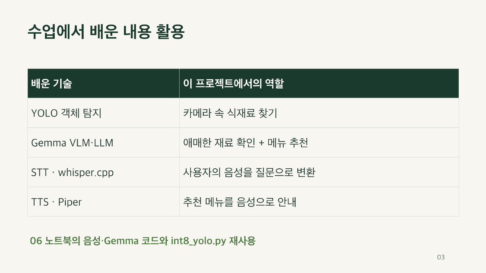
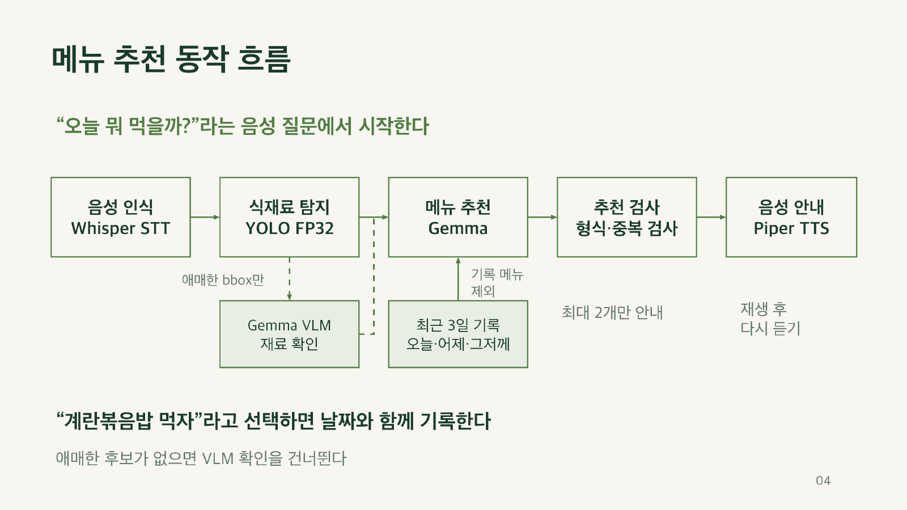
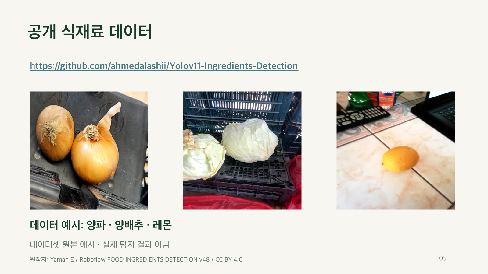
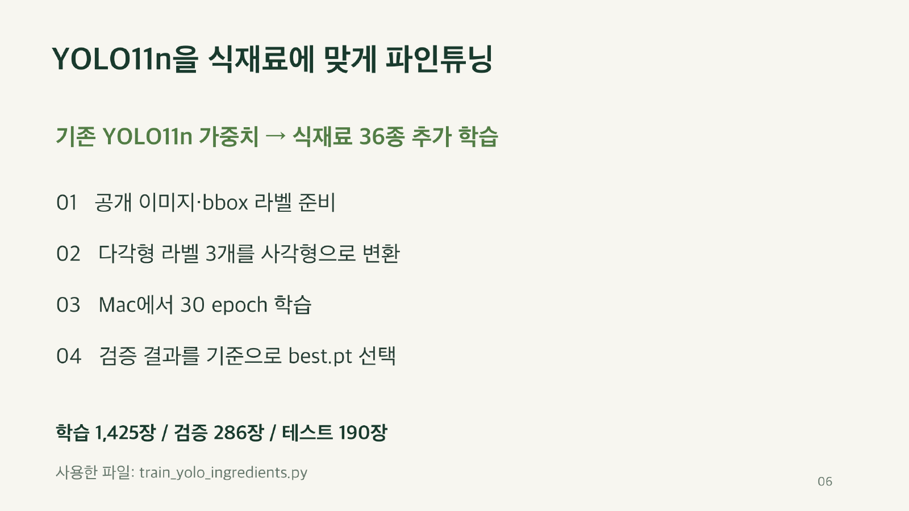
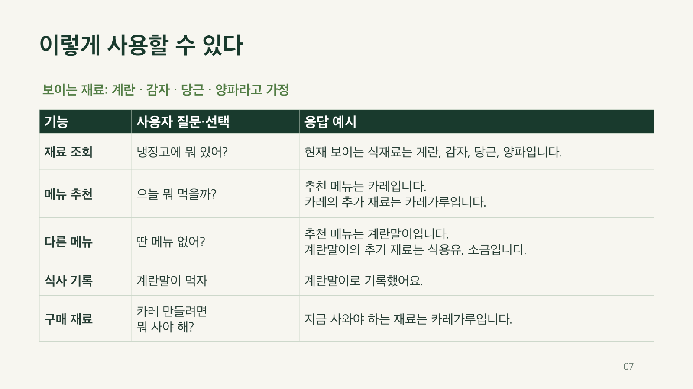
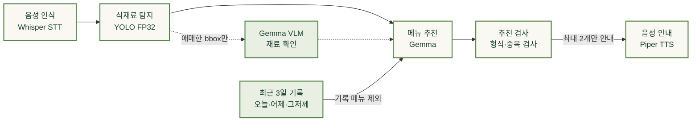

# 식재료 기반 음성 메뉴 추천

## 발표 자료

표지를 클릭하면 발표 PDF를 볼 수 있습니다.

[](Project02_presentation.pdf)

[발표 PDF 열기](Project02_presentation.pdf)

<details>
<summary>발표 자료 펼쳐보기 (전체 7페이지)</summary>

### 1페이지


### 2페이지


### 3페이지



### 4페이지



### 5페이지



### 6페이지



### 7페이지



</details>

## 시연 영상

### 전체 프로그램 시연

실제 Jetson에서 식재료 사진을 보여주며 실행한 전체 프로그램 시연 영상입니다.

https://github.com/user-attachments/assets/cd879d28-ee4c-4f15-a952-8e15c316f06f

[전체 시연 MP4 열기](full_demo.mp4)

### YOLO 식재료 탐지 시연

학습한 YOLO11n의 TensorRT FP32 엔진으로 식재료 사진을 탐지한 영상입니다. 박스·식재료 이름·confidence를 표시한다.

시연에서는 계란을 감자로 인식하는 등의 한계가 나타납니다. YOLO11n을 30 epoch 학습했지만, 이런 오인식의 원인을 모델 크기나 학습 횟수만으로 단정할 수는 없습니다. FP32는 정밀도를 낮춘 양자화가 아니며, 이 프로젝트에서는 TensorRT 엔진으로 변환해 추론 실행을 최적화했습니다.

https://github.com/user-attachments/assets/0d8b63f9-3ecc-4996-908b-8c69a6e2916a

[MP4 영상 열기](yolo_demo.mp4)

## 파일 구조

실행 코드는 기능별 네 파일로 나누고 각 파일 안에서는 함수 중심으로 구성했습니다.

```text
[Project02]/
├── main.py           # 음성 의도·추천 규칙·식사 기록·메인 루프
├── vision.py         # FP32 YOLO·카메라·애매한 bbox 묶음
├── gemma.py          # 별도 Python에서 Gemma VLM·메뉴 생성
├── speech.py         # 연속 음성 감지·whisper.cpp·Piper
├── ingredients_fp32.engine  # 최종 식재료 탐지 모델
├── yolo_demo.mp4      # YOLO 탐지 시연 영상 (10초)
├── full_demo.mp4      # 전체 프로그램 시연 영상 (음성 포함)
├── Project02_presentation.pdf  # 발표 자료
├── Project02_cover.png         # 발표 PDF 표지 미리보기
├── assets/slides/              # README에서 펼쳐 볼 발표 페이지 이미지
│   ├── page-2.png
│   ├── page-3.png
│   ├── page-4.png
│   ├── page-5.png
│   ├── page-6.png
│   └── page-7.png
├── .gitignore
└── README.md
```

발표 PDF는 `[Project02]/` 바로 아래에 두었다. 1페이지 미리보기는 `Project02_cover.png`를 사용하고, 2~7페이지 이미지는 `assets/slides/`에 보관한다.

<br>

## 실행 방식

아래에서 **프로젝트 루트 디렉토리**는 `[Project02]`, `.venv`, `.piper_venv`, `src`, `whisper.cpp`를 두는 최상위 디렉토리를 뜻한다. 각 명령 블록은 별도 안내가 없으면 해당 디렉토리에서 시작한다.

### Jetson 실행 환경

2026년 11월 8일 SSH로 확인한 환경이다. 모델을 실행할 Jetson의 시스템 CUDA·TensorRT를 사용하며, 필요한 파이썬 패키지를 가상환경에 설치한다.

| 항목 | 확인한 구성 |
| --- | --- |
| 장치 | NVIDIA Jetson Orin Nano Engineering Reference Developer Kit Super |
| 운영체제·아키텍처 | Ubuntu 22.04.5 LTS · aarch64 |
| Jetson Linux L4T | 36.5.2 (`nvidia-l4t-core`: `36.5.2-20260716114719`) |
| CUDA / TensorRT | CUDA Toolkit 12.6 (`nvcc` 12.6.68) / TensorRT 10.3.0 |
| Python | 3.10.12 |
| OpenCV | 4.5.4 · 시스템 패키지 · GStreamer YES (1.19.90) · GTK3 |
| PyTorch / torchvision | 2.8.0 (CUDA 12.6) / 0.23.0 |
| Ultralytics | 8.4.194 |
| llama-cpp-python | 0.3.36 · CUDA GPU 오프로딩 지원 확인 |
| NumPy / Pillow | 1.23.0 / 10.4.0 |
| 모델 다운로드 도구 | huggingface-hub 2.4.0 / python-dotenv 1.2.4 |
| Piper | 별도 `.piper_venv` · Python 3.10.12 · piper-tts 1.8.0 |
| Whisper | whisper.cpp의 `build-cpu/bin/whisper-cli` · CUDA OFF인 CPU 빌드 |

L4T 버전은 시스템에서 직접 확인한 값이다. `nvidia-jetpack` 메타패키지는 설치되어 있지 않아 JetPack 버전 번호는 별도로 단정하지 않는다. 아래 설치 명령은 노트북과 확인한 패키지 구성을 바탕으로 정리했으며, 새 장치에서 전체 구축을 다시 실행한 것은 아니다.

### 가상환경 구축

**YOLO·Gemma용 `.venv`**

[00 노트북](../lecture_ipynb_files/00_Initial-Setup.ipynb)처럼 시스템 패키지를 참조하는 가상환경을 만든다. CUDA 12.6과 TensorRT가 준비된 Jetson을 전제로 하며, OpenCV와 TensorRT의 Python 바인딩은 시스템 패키지를 사용한다. 이미 `.venv`가 있으면 생성·재설치 단계는 생략하고 활성화한다.

```bash
sudo apt update
sudo apt install -y python3-venv python3-dev python3-opencv python3-libnvinfer \
    python3-matplotlib build-essential cmake git libopenblas-dev libcurl4-openssl-dev \
    alsa-utils pulseaudio-utils v4l-utils gstreamer1.0-tools gstreamer1.0-plugins-good wget
python3 -m venv --system-site-packages .venv
source .venv/bin/activate
python -m pip install --upgrade pip setuptools wheel
python -m pip install "numpy==1.23.0" "Pillow==10.4.0"
```

[03 노트북](../lecture_ipynb_files/03_DL-and-GPU.ipynb)의 Jetson CUDA 12.6용 패키지 인덱스로 PyTorch와 torchvision을 설치한다. 아래 명령은 해당 Jetson 환경용이며 일반 PC용 PyTorch 설치 명령과 구분한다.

```bash
source .venv/bin/activate
python -m pip install --no-deps torch==2.8.0 torchvision==0.23.0 \
    --index-url https://pypi.jetson-ai-lab.io/jp6/cu126
python -m pip install "sympy>=1.13.3" "typing_extensions>=4.10.0,<5" \
    "filelock>=3.16.1,<4" "networkx>=2.5.1" jinja2 fsspec
python -m pip install pyyaml requests psutil
python -m pip install --no-deps ultralytics==8.4.194
python -m pip install huggingface_hub==2.4.0 python-dotenv==1.2.4
```

Ultralytics의 `--no-deps`는 [04 노트북](../lecture_ipynb_files/04_DL-Object-Detection.ipynb)의 방식이다. 시스템의 GStreamer 지원 OpenCV와 Jetson용 PyTorch를 유지하기 위한 구성이며, Ultralytics가 선언한 전체 의존성 목록을 자동 설치하는 방식은 아니다. 모델 학습·ONNX 변환용 패키지는 완성된 엔진을 실행하는 데 필요하지 않아 제외했다.

[05 노트북](../lecture_ipynb_files/05-LLM_and_Gemma.ipynb)의 CUDA 빌드 방식으로 Gemma 실행에 필요한 `llama-cpp-python`을 설치한다. Orin의 CUDA 아키텍처 87을 지정하고, 빌드 병렬 수는 2로 제한한다.

```bash
source .venv/bin/activate
export PATH=/usr/local/cuda-12.6/bin:$PATH
export LD_LIBRARY_PATH=/usr/local/cuda-12.6/lib64:${LD_LIBRARY_PATH:-}
CUDACXX=/usr/local/cuda-12.6/bin/nvcc \
CMAKE_ARGS="-DGGML_CUDA=on -DCMAKE_CUDA_COMPILER=/usr/local/cuda-12.6/bin/nvcc -DCMAKE_CUDA_ARCHITECTURES=87" \
CMAKE_BUILD_PARALLEL_LEVEL=2 \
python -m pip install --no-cache-dir --no-binary=llama-cpp-python "llama-cpp-python==0.3.36"
```

**Piper용 `.piper_venv`**

[06 노트북](../lecture_ipynb_files/06-Vision_LLM_Multimodal_Systems.ipynb)의 별도 음성 합성 환경을 준비한다. 프로그램이 이 환경의 Python을 직접 호출하므로 메인 환경과 합칠 필요가 없다.

```bash
python3 -m venv .piper_venv
.piper_venv/bin/python -m pip install piper-tts==1.8.0
```

**Whisper CPU 실행 파일 빌드**

06 노트북의 `build-cpu` 경로를 사용한다. 코드가 CPU 실행 파일을 호출하므로 CUDA용 Whisper 빌드는 필요하지 않다. `whisper.cpp`가 이미 있다면 clone은 생략한다.

```bash
git clone https://github.com/ggml-org/whisper.cpp.git
cmake -S whisper.cpp -B whisper.cpp/build-cpu \
    -DGGML_CUDA=OFF -DGGML_BLAS=OFF -DCMAKE_BUILD_TYPE=Release
cmake --build whisper.cpp/build-cpu --target whisper-cli -j2 --config Release
```

확인한 장치의 whisper.cpp 커밋은 `727d3e7666485e12450746b523bfb4e7f057cc5e`다. 위 clone은 현재 저장소를 받는 명령이며, 같은 소스 버전으로 재현하려면 새로 받은 저장소에서 빌드 전에 `git -C whisper.cpp checkout 727d3e7666485e12450746b523bfb4e7f057cc5e`를 실행한다.

### 별도로 준비할 모델

GitHub에는 직접 학습한 `ingredients_fp32.engine`만 포함한다. Gemma 본체·이미지 입력용 mmproj·Whisper·Piper 모델은 강의 환경의 파일을 사용하고, 없으면 아래 방법으로 준비한다. 이미 같은 파일이 있다면 다시 다운로드할 필요는 없다.

아래 경로는 모두 프로젝트 루트 디렉토리 기준이다. YOLO 엔진만 `[Project02]` 폴더에 두며, 나머지는 노트북과 같은 상대 경로를 사용한다.

| 용도                     | 필요한 파일 경로                                                    |
| ------------------------ | ------------------------------------------------------------------- |
| 식재료 탐지              | `[Project02]/ingredients_fp32.engine` — 저장소에 포함               |
| Gemma 본체               | `src/models/Gemma4/google_gemma-4-E2B-it-Q4_K_M.gguf`               |
| Gemma 이미지 입력        | `src/models/Gemma4/mmproj-google_gemma-4-E2B-it-f16.gguf`           |
| Whisper 한국어 음성 인식 | `whisper.cpp/models/ggml-base.bin`                                  |
| Piper 한국어 음성 합성   | `src/models/Piper/ko_KR-kss-medium.onnx`와 같은 이름의 `.onnx.json` |

**Gemma 본체와 mmproj**

05 노트북의 `hf_hub_download()` 방식을 사용한다. 다운로드 원본은 [bartowski의 Gemma GGUF 저장소](https://huggingface.co/bartowski/google_gemma-4-E2B-it-GGUF/tree/main)이며, 함수 사용법은 [Hugging Face 다운로드 문서](https://huggingface.co/docs/huggingface_hub/guides/download)를 참고한다. 본체와 mmproj 두 파일을 모두 준비해야 사진을 입력할 수 있다.

```bash
# 프로젝트 루트 디렉토리에서 실행
.venv/bin/python - <<'PY'
import os
from dotenv import load_dotenv
from huggingface_hub import hf_hub_download

load_dotenv(".env")

for filename in [
    "google_gemma-4-E2B-it-Q4_K_M.gguf",
    "mmproj-google_gemma-4-E2B-it-f16.gguf",
]:
    path = hf_hub_download(
        repo_id="bartowski/google_gemma-4-E2B-it-GGUF",
        filename=filename,
        local_dir="src/models/Gemma4",
        token=os.getenv("HF_TOKEN"),
    )
    print(path)
PY
```

`huggingface_hub`와 `python-dotenv`는 위 가상환경 구축 단계에서 설치한다. 인증이 필요한 경우에는 05 노트북처럼 프로젝트 루트 디렉토리의 `.env`에 설정한 `HF_TOKEN`을 사용한다. 토큰은 코드나 GitHub에 넣지 않는다.

**Whisper base 모델**

06 노트북처럼 [whisper.cpp의 모델 다운로드 스크립트](https://github.com/ggml-org/whisper.cpp/blob/master/models/download-ggml-model.sh)를 실행한다. 한국어 입력이므로 영어 전용 `base.en` 대신 `base`를 받는다.

```bash
# 프로젝트 루트 디렉토리에서 실행
(cd whisper.cpp && sh ./models/download-ggml-model.sh base)
```

파일은 `whisper.cpp/models/ggml-base.bin`에 저장된다. 이 명령은 모델만 받으며, 실행 파일은 위 CPU 빌드 단계에서 준비한다.

**Piper 한국어 음성 모델**

06 노트북의 다운로드 명령을 Piper 가상환경의 Python으로 실행한다.

```bash
# 프로젝트 루트 디렉토리에서 실행
mkdir -p src/models/Piper
.piper_venv/bin/python -m piper.download_voices \
    ko_KR-kss-medium \
    --data-dir src/models/Piper
```

음성 모델 `.onnx`와 설정 `.onnx.json`이 함께 필요하다. Piper 환경은 위 별도 가상환경 구축 단계에서 준비한다.

준비가 끝난 폴더 구조는 다음과 같다. 모델 다운로드와 실행 환경 구축을 모두 완료해야 한다.

```text
프로젝트 루트 디렉토리/
├── .venv/
├── .piper_venv/
├── .env                         # 인증이 필요한 경우에만 준비
├── src/models/
│   ├── Gemma4/                  # Gemma 본체와 mmproj
│   └── Piper/                   # 한국어 .onnx와 .onnx.json
├── whisper.cpp/
│   ├── build-cpu/bin/whisper-cli
│   └── models/ggml-base.bin
└── [Project02]/
    ├── main.py
    ├── vision.py
    ├── gemma.py
    ├── speech.py
    └── ingredients_fp32.engine
```

완성된 TensorRT 엔진은 다른 GPU·TensorRT 버전에서 그대로 호환된다고 보장할 수 없다. 위 환경과 다른 장치에서는 엔진 호환성을 확인하고, 로딩에 실패하면 대상 환경에서 원본 가중치로 엔진을 다시 만들어야 한다.

### 실행 환경

프로젝트 루트 디렉토리 안에 `[Project02]`를 두고 실행한다. 카메라, 마이크, 스피커가 필요하다.

YOLO는 식재료를 학습한 YOLO11n의 TensorRT FP32 엔진을 사용한다. Gemma는 이미지도 입력할 수 있는 VLM 구성을 사용하고, 음성 인식에는 whisper.cpp, 음성 합성에는 Piper를 사용한다.

Piper는 노트북처럼 `.piper_venv/bin/python -m piper`를 별도 프로세스로 호출한다. Gemma는 현재 활성화한 환경의 Python 프로세스에서 모델을 한 번 로딩해 재사용하므로 가상환경을 합칠 필요가 없다. YOLO가 설치된 Python으로 메인 프로그램을 실행한다.

```bash
# 프로젝트 루트 디렉토리에서 실행
source .venv/bin/activate
export PATH=/usr/local/cuda-12.6/bin:$PATH
export LD_LIBRARY_PATH=/usr/local/cuda-12.6/lib64:${LD_LIBRARY_PATH:-}
cd '[Project02]'
python main.py
```

위 가상환경을 활성화한 상태에서 실행한다. Gemma는 현재 Python을 사용하므로 같은 환경에 `llama_cpp`와 노트북의 `Gemma4ChatHandler`가 있어야 한다. 모델·실행 파일은 `[Project02]`의 상위 폴더를 기준으로 찾으므로 별도 경로 인수를 받지 않는다. 필요한 Gemma·Whisper·Piper 모델 경로는 `gemma.py`, `speech.py`에 노트북 경로로 지정했다. 새 모델이나 패키지를 자동으로 다운로드하지 않는다.

마이크 기본값은 `plughw:CARD=Microphone,DEV=0`이다. 연결한 장치 이름이 다르면 `--mic-device`로 바꾼다. 카메라는 `vision.py`의 `/dev/video0` GStreamer 파이프라인을 사용한다. 해당 Jetson의 OpenCV에서 GStreamer가 동작해야 한다. 실행 전 최종 엔진을 이 폴더의 `ingredients_fp32.engine`에 둬야 하며, 모델이 없으면 오류로 중단한다.

입력은 키나 버튼 없이 연속 감지한다. 노트북의 녹음 형식은 유지하고, 고정 5초 대신 PCM 음량으로 말의 시작·끝을 구분한다. 초기 RMS 기준은 500, 종료 무음 0.8초, 최대 발화 15초다. `--rms-threshold`로 음량 기준을 바꿀 수 있다. 녹음 프로세스는 STT 전에 닫고, 처리·TTS 중에는 열지 않는다. 답변 뒤 자동으로 다시 듣고, 종료는 `Ctrl+C`다. 오디오 프로그램 실패 때는 오류를 표시하고 종료하므로 장치를 확인해 재실행한다.

YOLO 시작 기준은 탐지 0.15, 바로 수용 0.65이며 `--detect-conf`, `--accept-conf`로 조정한다. **이 값들과 음성 감지값은 실물로 검증한 값이 아니다.**

Mac에서는 도움말과 장치 없는 로컬 테스트를 실행할 수 있다. 실제 모델을 쓰는 전체 프로그램은 Jetson에서 검증해야 한다.

```bash
python3 '[Project02]/main.py' --help
python3 -m unittest discover -s '[Project02]/tests' -v
```

테스트 명령은 로컬 `tests/`가 있는 개발 폴더 기준이다. 테스트 파일은 요청에 따라 Git에 포함하지 않으므로 새 clone에는 없다.

### 카메라·마이크·스피커 설정

| 장치 | 코드의 설정 | 변경 위치 |
| --- | --- | --- |
| USB 카메라 | `/dev/video0` · YUY2 · 640 × 480 · 30 FPS 요청 · BGR 변환 | `vision.py`의 GStreamer `pipeline` |
| USB 마이크 | `plughw:CARD=Microphone,DEV=0` · 16 kHz · 16비트 PCM · 모노 | 실행 인수 `--mic-device` |
| 발화 감지 | RMS 500 · 종료 무음 0.8초 · 최대 15초 | RMS는 `--rms-threshold`, 나머지는 `speech.py` |
| 스피커 | `aplay`의 기본 ALSA 출력 장치 | OS의 기본 오디오 출력 설정 |

카메라는 관측할 때 열어 90프레임을 읽은 뒤 닫고 마지막 프레임을 분석한다. 30 FPS 요청 기준으로 약 3초 동안 안정화하려는 처리이며, 실제 촬영·분석 속도를 측정한 값은 아니다.

먼저 장치를 연결하고 이름과 지원 형식을 확인한다.

```bash
v4l2-ctl --list-devices
v4l2-ctl --device=/dev/video0 --list-formats-ext
arecord -l
arecord -L
aplay -l
aplay -L
pactl list short sinks
pactl get-default-sink
pactl get-sink-volume @DEFAULT_SINK@
```

마이크의 ALSA 카드 이름이 `Microphone`인지 확인한다. 카드 번호는 재연결 시 바뀔 수 있어 코드의 기본값처럼 이름을 사용한다. 다른 이름이면 `[Project02]` 폴더에서 `python main.py --mic-device 'plughw:CARD=실제_카드_이름,DEV=0'`으로 실행한다.

스피커는 데스크톱의 소리 설정에서 연결한 출력 장치를 선택한다. PulseAudio를 기본 출력으로 사용하는 환경이라면 아래 명령으로도 설정할 수 있다. 첫 줄의 이름은 `pactl list short sinks`에서 확인한 실제 이름으로 바꾼다. 프로그램은 `aplay`를 쓰므로 ALSA 기본 출력도 해당 장치로 연결되어 있어야 한다.

```bash
pactl set-default-sink '실제_출력_장치_이름'
pactl set-sink-mute @DEFAULT_SINK@ 0
pactl set-sink-volume @DEFAULT_SINK@ 50%
```

장치를 직접 확인할 때는 다음처럼 3초 녹음 후 재생할 수 있다. 이 명령은 실행한 디렉토리에 `mic_test.wav`를 만든다. 코드와 같은 `pasuspender` 방식으로 녹음하므로 동일 사용자로 실행하고, 실제로 소리가 들리는지 확인한다.

```bash
pasuspender -- arecord -D 'plughw:CARD=Microphone,DEV=0' \
    -f S16_LE -r 16000 -c 1 -d 3 mic_test.wav
aplay mic_test.wav
```

2026년 11월 8일 SSH 점검 당시에는 USB 카메라와 `Microphone` 카드가 연결되어 있지 않았다. 기본 출력도 USB 스피커가 아닌 내장 오디오로 잡혀 있어, 이번 점검에서 실제 촬영·녹음·청취를 검증하지는 않았다. 장치 연결 후 위 설정을 확인해야 한다.

### 실행 전 환경 확인

프로젝트 루트 디렉토리에서 실행한다. 패키지 버전뿐 아니라 CUDA 지원, Gemma 이미지 입력 핸들러, 오디오 실행 파일을 확인한다.

```bash
source .venv/bin/activate
python - <<'PY'
import cv2
import torch
import torchvision
import tensorrt
import llama_cpp
from ultralytics import YOLO
from llama_cpp.llama_chat_format import Gemma4ChatHandler

print("OpenCV:", cv2.__version__)
for line in cv2.getBuildInformation().splitlines():
    if "GStreamer:" in line:
        print(line.strip())
print("PyTorch:", torch.__version__, "CUDA:", torch.version.cuda)
print("CUDA 사용 가능:", torch.cuda.is_available())
print("TensorRT:", tensorrt.__version__)
print("Gemma GPU 지원:", llama_cpp.llama_supports_gpu_offload())
print("YOLO·torchvision·Gemma4ChatHandler 임포트 완료")
PY
.piper_venv/bin/python -m piper --help
whisper.cpp/build-cpu/bin/whisper-cli --help
```

현재 Jetson에서 YOLO·torchvision·TensorRT·Gemma4ChatHandler 임포트, CUDA 사용 가능 여부, Gemma GPU 지원, Piper·Whisper 도움말 실행과 필요한 모델 파일의 존재를 확인했다. 모델 파일의 존재 확인은 전체 추론 성공을 뜻하지 않으며, 새 가상환경 구축과 장치를 연결한 전체 실행은 별도 검증이 필요하다.

### 처리 과정

발표 자료 4페이지의 메뉴 추천 동작 흐름을 옮기면 다음과 같다. “오늘 뭐 먹을까?”라는 음성 질문에서 시작한다.



애매한 후보가 없으면 VLM 확인을 건너뛴다. 음성 안내를 재생한 뒤 다시 사용자 말을 듣고, “계란볶음밥 먹자”처럼 메뉴를 선택하면 날짜와 함께 기록한다.

코드는 다음 순서로 연결했다. 실제 장치의 전체 실행은 아직 검증하지 않았다.

1. 마이크에서 말을 연속 감지하고, 사용자가 말한 한 구간을 STT로 텍스트로 바꾼다.
2. “오늘 뭐 먹을까?”처럼 메뉴를 물어보는 질문이면 추천을 시작한다.
3. 카메라에서 현재 식재료가 보이는 사진 한 장을 가져온다.
4. YOLO로 식재료를 탐지한다.
5. confidence가 충분히 높은 재료는 바로 사용한다. 애매한 후보만 사진에서 잘라 하나의 이미지로 모으고, Gemma VLM에 한 번 전달해 확인한다. 애매한 후보가 없으면 이미지 분석은 생략한다.
6. 파일에서 최근 3일간 먹기로 선택한 메뉴를 읽는다.
7. Gemma가 재료와 최근 식사 기록을 보고 메뉴를 자유롭게 제안한다.
8. 코드에서 출력 형식, 재료 ID, 메뉴 중복과 최근 식사 일치 여부를 검사한다.
9. 정해진 문장을 Piper로 음성 합성하고 스피커로 들려준다.
10. 사용자가 “그래, 계란말이 먹자”처럼 메뉴명을 말하며 먹기로 정하면 추천 여부와 관계없이 날짜와 함께 `recent_meals.json`에 저장한다.

사용자에게 인식한 재료가 맞는지 다시 물어보는 단계는 두지 않는다. 바로 추천하되, 재료를 확인하지 못한 경우에는 다시 촬영할 수 있도록 안내한다.

Gemma의 이미지 분석과 메뉴 추천은 구분한다. 이미지 분석은 애매한 후보가 있을 때만 하고, 메뉴 추천은 정리된 재료 목록으로 진행한다. VLM이 확인하지 못한 후보는 빼고, YOLO에서 확실하게 탐지한 재료는 유지한다. YOLO가 처음부터 놓친 재료까지 찾아주는 방식은 아니다. confidence 기준값과 실제 속도는 사진을 보며 확인해야 한다.

사진과 음성은 고정된 파일에 저장하고 다음 질문 때 덮어쓴다. 질문마다 폴더를 만들거나 사진·음성·상세 로그를 모아 두는 기능은 만들지 않는다. 식사 결정 파일은 다음 추천에도 필요하므로 별도로 유지한다.

### 메뉴 추천과 출력 형식

“냉장고에 식재료 뭐뭐 있어?”라고 물으면 현재 사진을 보고 종류만 알려준다. 예를 들어 “현재 보이는 식재료는 계란, 감자, 당근입니다.”라고 말한다. 같은 재료가 여러 개 보여도 이름은 한 번만 말하고 개수는 알려주지 않는다. 이 질문에서는 메뉴를 추천하거나 식사 기록을 갱신하지 않는다. 아래는 메뉴를 추천해 달라고 물었을 때의 동작이다.

한 번에 서로 다른 메뉴를 최대 두 개 추천한다. 유효한 메뉴가 한 개뿐이면 한 개만 안내한다. 여러 보유 재료를 조합해도 되고, 없는 재료를 조금 추가로 준비하는 메뉴도 제안할 수 있다. 레시피나 선정 이유는 말하지 않고, 필요한 추가 재료만 짧게 안내한다.

```text
추천 메뉴는 A, B입니다.
```

추가로 살 재료가 있다면 다음처럼 덧붙인다. 아래는 출력 형식 예시이며 완전한 레시피는 아니다.

```text
추천 메뉴는 카레, 채소잡채입니다.
카레의 추가 재료는 카레가루입니다.
채소잡채의 추가 재료는 당면, 간장입니다.
```

예를 들어 감자·당근·양파를 활용하면서 카레가루를 추가로 준비하는 메뉴를 제안할 수 있다. 추가 재료를 이미 냉장고에 있는 것으로 취급하지는 않는다. 매장 재고나 가격을 검색하는 기능은 만들지 않는다.

최근 3일간 먹기로 선택한 메뉴는 추천에서 제외한다. 한 번의 추천 안에서도 같은 메뉴가 두 번 나오면 안 된다. `계란말이`와 `계란말이`처럼 등록된 다른 이름도 같은 음식으로 비교한다.

최근 3일은 한국 시간 기준 오늘·어제·그저께다. 메뉴 개수로 자르지 않고 이 기간에 선택한 기록을 모두 사용한다. 사용자가 메뉴명을 명확히 말하며 먹기로 정하면 메뉴와 선택 날짜를 저장하고, 다음 추천에서 제외한다. 추천 밖의 메뉴나 추천을 받기 전의 선택도 저장할 수 있다.

추천만 했고 사용자가 선택하지 않은 음식은 다음 질문에서 다시 추천할 수 있다. 선택 발화를 처리할 때는 카메라와 YOLO·VLM을 다시 실행하지 않는다. “좋아”처럼 어느 메뉴인지 모호한 말이나 부정 표현에는 저장하지 않는다.

“둘 다 먹자”라고 하면 현재 이벤트에서 마지막으로 안내한 메뉴를 모두 기록한다. 한 개만 안내했다면 그 메뉴만 기록한다. 무엇을 먹기로 했는지 불명확하면 “그래서 뭘 드시나요? 알려주세요!”라고 물어본다. 참조할 추천이 없는 경우에도 임의로 메뉴를 정하지 않는다.

첫 추천과 이어지는 “딴 메뉴 없어?”를 하나의 이벤트로 본다. 그동안 안내한 메뉴는 메모리에만 잠시 두어 같은 이벤트에서 다시 추천하지 않는다. 메뉴 선택을 저장하거나 사용자가 그만두거나 더 이상 후보가 없어 이벤트가 끝나면 비운다. 다음 이벤트까지 추천 이력을 파일로 남기지는 않는다.

유효한 메뉴가 한 개면 그대로 추천한다. “딴 메뉴 없어?”라고 물으면 같은 이벤트에서 앞서 안내한 메뉴를 빼고 대안을 추천한다. 더 이상 유효한 후보가 없으면 “추천할 메뉴가 없어요”라고 안내한다. 최근 메뉴를 재사용하거나 없는 재료를 보유한 것처럼 꾸미지 않는다. 필요한 구매 재료는 별도로 안내한다.

### 원하는 메뉴의 구매 재료 조회

사용자가 메뉴를 정해 놓고 필요한 재료만 물어볼 수도 있다.

```text
사용자: 나 카레가 먹고 싶어. 지금 사와야 하는 재료가 뭐야?
응답: 지금 사와야 하는 재료는 카레가루입니다.
```

위 응답은 카레에 필요한 재료가 감자·당근·양파·카레가루이고, 앞의 세 재료가 보인다고 가정한 형식 예시다. 실제 모델 응답이나 현장 검증 결과는 아니다.

`카레 만들려면 뭐 사야 해?`, `카레에 필요한 재료 알려줘` 같은 질문도 처리한다. 질문에서 메뉴를 구분한 뒤 현재 사진을 새로 분석하고, Gemma에는 해당 요리의 **전체 필요 재료**를 요청한다. 그중 보유한 종류를 빼는 계산은 코드에서 한다. 한영 이름과 등록된 별칭으로 비교해 `egg`·`달걀`·`계란`을 같은 재료로 다룬다. 남은 목록은 중복을 제거하고, 학습 클래스에 없는 카레가루·당면 같은 재료도 안내할 수 있다.

필요 재료가 전부 보유 목록에 있으면 `지금 사와야 하는 재료는 없어요.`라고 답한다. 메뉴가 없거나 불명확하면 촬영 전에 이름을 묻는다. 재료를 인식하지 못했을 때는 빈 냉장고라고 가정해 모든 재료를 사라고 하지 않고 인식 실패를 알린다.

이 질문은 메뉴 추천이나 식사 결정과 구분한다. 식사 파일을 읽거나 쓰지 않고, 이전 추천의 재료·안내 메뉴 문맥도 유지한다. `먹고 싶어`라는 말만으로 먹기로 정했다고 기록하지 않는다.

Gemma 응답은 메뉴명과 비어 있지 않은 재료 목록인지 검사하고, 형식이 잘못되면 한 번만 보완 요청한다. 모든 필수 재료가 빠짐없이 제안됐는지는 코드로 보장하지 못한다. 양념도 자동 보유로 가정하지 않으며, 가격·매장 재고·수량·레시피는 안내하지 않는다.

## 창의성 및 확장성

### 주제 선정 이유

우리 어머니는 가족의 하루 세 끼를 매일 책임지신다. 냉장고에 식재료가 있어도 “오늘은 무슨 요리를 하지?”라는 고민을 계속하신다.

그래서, 나는 냉장고에 있는 식재료와 최근에 먹은 음식을 보고 메뉴를 추천해 주면 어머니의 부담을 조금 줄일 수 있겠다고 생각했다. 요리하는 방법을 알려주는 것보다, 일단 오늘 무엇을 먹을지 결정하는 데 도움을 주는 것을 목표로 잡았다.

### 아이디어 설명

이번 시연에서는 식재료를 책상 위에 두고, 그 공간이 냉장고 안이라고 가정한다. 사용자가 “무슨 요리를 할까?”라고 질문하면 카메라로 식재료를 보고, 최근에 먹지 않은 음식 중 만들 수 있을 만한 메뉴를 최대 두 개 음성으로 추천한다.

사용자가 추천을 듣고 “그래, ○○ 먹자”라고 선택하면 프로그램이 식사 기록 파일을 갱신하는 것으로 바꿨다. 실제로 먹는 모습을 감지한 것은 아니고, 그 메뉴를 먹기로 결정했다고 기록한다. 따라서 별도의 식사 기록 장치는 가정하지 않는다.

또한, 메뉴를 미리 정해 둔 목록에서 고르는 방식이 아니라 Gemma가 자유롭게 제안하도록 했다. 대신 같은 음식이 반복되거나 형식에 맞지 않는 결과가 그대로 출력되지 않도록 코드에서 검사하는 구조를 설계했다.

### 창의적인 요소

단순히 식재료의 이름을 알려주는 것에서 끝나지 않고, 그 재료로 오늘 무엇을 먹을지 고민하는 상황과 연결했다. 최근 식사 기록을 함께 사용해서 같은 메뉴가 반복되는 것도 줄이고자 했다.

음성으로 질문하고 결과도 음성으로 들을 수 있게 해서, 손으로 재료를 만지거나 요리를 준비하면서도 사용할 수 있는 방향으로 생각했다. 실제로 얼마나 편리한지와 기다리는 시간이 괜찮은지는 전체 기능을 연결한 뒤 확인해야 한다.

### 구현한 내용

기능명세에 따라 음성 입출력, YOLO·조건부 VLM 확인, 자유 메뉴 생성, 최근 3일 선택 기록과 이벤트별 중복 제외를 구현했다. 장치 없는 로컬 규칙·오류 처리 테스트를 실행했으며, 실제 Jetson의 모델·음성·카메라 연결 검증은 남아 있다.

식재료 탐지를 위한 YOLO11n은 별도 준비 작업으로 Mac에서 30 epoch 학습을 마쳤다. 최종 실행에는 TensorRT FP32 엔진을 사용한다. 현장 카메라 비교 후 FP32를 선택했고, 클래스 이름 정보를 붙인 엔진을 Project02에 배치했다. 이 비교는 정량 정확도 평가가 아니며 계란 등 일부 재료의 오인식은 남아 있다.

### 확장성

가족마다 자주 먹는 음식이나 좋아하는 음식이 다르기 때문에, 이후에는 가족의 선호와 조리 가능 시간을 반영하는 방향으로 확장할 수 있을 것 같다.

실제 냉장고와 식사 기록 장치까지 연결하면 재료를 따로 펼쳐 놓거나 기록 파일을 준비하는 과정도 줄일 수 있을 것이다. 다만, 이 부분은 현재 구현 범위가 아니라 앞으로의 아이디어다.

<br>

## 기타 참고 사항

### 작업 중 확인한 문제점

#### 기본 YOLO 모델의 식재료 종류

처음에는 기본 YOLO11n으로 식재료를 바로 탐지할 수 있을 것으로 생각했다. 하지만 기본 COCO 클래스에는 당근 등 일부 식재료만 있고, 계란이나 양파, 감자처럼 필요한 재료가 모두 들어 있지는 않았다.

그래서 공개 식재료 데이터셋을 사용해 YOLO11n을 별도로 학습했다. 받은 저장소 사본은 총 1,901장이며, 학습 1,425장, 검증 286장, 테스트 190장으로 나뉘어 있다. 재료별 데이터 수의 차이가 크므로 실제로 잘 인식되는 재료는 따로 확인해야 한다.

#### 데이터 준비와 학습 방법

데이터는 Yaman E의 Roboflow **Food Ingredients Detection v48**을 담은 공개 저장소 `ahmedalashii/Yolov11-Ingredients-Detection`의 사본을 사용했다. 내려받을 때 기록한 데이터셋 라이선스는 CC BY 4.0이다. 사용한 사본은 식재료 36종, 총 1,901장으로, 원본 안내의 1,904장과 차이가 있다. 학습에는 사본에 포함된 학습·검증·테스트 분할을 그대로 사용했다.

이미지와 라벨 수, 클래스 번호, 좌표 형식을 검사했다. 일부 라벨에 섞여 있던 다각형 주석 3개는 모든 꼭짓점을 감싸는 사각형으로 바꿔, YOLO 객체 탐지 형식인 `클래스 번호, 중심 x, 중심 y, 너비, 높이`로 통일했다. 좌표는 이미지 크기에 대해 정규화했으며, 원본 라벨은 별도로 백업했다.

학습은 처음부터 모델을 만드는 대신, 사전 학습된 `yolo11n.pt`를 불러와 식재료 36종에 맞게 파인튜닝하는 방식으로 진행했다. 실제 완료된 학습 설정은 다음과 같다.

| 항목          | 설정                                                                               |
| ------------- | ---------------------------------------------------------------------------------- |
| 학습 환경     | Mac, Apple GPU의 MPS 사용                                                          |
| 모델          | Ultralytics YOLO11n                                                                |
| 학습 데이터   | 1,425장                                                                            |
| 검증 데이터   | 286장                                                                              |
| 테스트 데이터 | 190장, 학습·검증에 사용하지 않음                                                   |
| 학습 횟수     | 30 epoch                                                                           |
| 입력 크기     | 416 × 416                                                                          |
| 배치 크기     | 8                                                                                  |
| 데이터 로더   | `workers=0`, `cache=False`                                                         |
| 데이터 증강   | 색상 변화, 이동·크기 조절, 좌우 반전, Mosaic 사용. 마지막 10 epoch에는 Mosaic 해제 |

학습 중 검증 결과를 기준으로 저장된 `best.pt`를 배포용 변환에 사용했다. 학습 종료 후 최적 가중치의 검증 기록은 mAP@50 약 **0.822**, mAP@50–95 약 **0.606**이다. 이는 Mac에서 PyTorch 모델을 검증한 결과이며, 최종 TensorRT 엔진의 정확도나 실제 카메라 환경의 성능을 뜻하지는 않는다.

#### TensorRT 최적화와 최종 모델 선택

학습한 가중치를 Jetson으로 옮긴 뒤, PyTorch 모델을 ONNX로 내보내고 Jetson의 TensorRT `trtexec`로 추론 엔진을 만드는 흐름을 사용했다. 변환 시 입력은 **640 × 640**, 배치는 **1**, 입력 크기는 고정으로 설정했다. 학습 입력 416 × 416과 배포 입력 640 × 640은 서로 다른 설정이다. ONNX 내보내기에는 그래프 단순화와 opset 20을 지정했다.

최적화 코드에는 FP32·FP16 엔진 생성과 INT8 양자화 경로를 마련했다. FP16은 연산 정밀도를 낮추는 방식이고, INT8은 학습 이미지 중 500장을 사용해 보정하는 방식이다. INT8 보정 이미지는 난수 시드 42로 선택하되 36개 클래스가 모두 포함되도록 했으며, 검증·테스트 이미지는 넣지 않도록 구성했다. 이 내용은 코드에 구현한 변환 방법이며, 모든 정밀도의 변환·성능 검증이 완료됐다는 의미는 아니다.

최종 프로그램에는 현장 카메라 비교 후 선택한 **FP32 TensorRT 엔진**을 사용했다. FP32는 가중치를 16비트나 8비트로 줄이는 양자화가 아니라, 32비트 부동소수점 정밀도를 유지하는 방식이다. 여기서의 최적화는 모델 구조를 줄이거나 가지치기하는 것이 아니라, TensorRT가 Jetson GPU에 맞게 실행 그래프와 커널을 최적화한 엔진으로 추론하는 것이다.

엔진에는 36개 클래스 이름과 입력 크기 등의 메타데이터를 붙여 Ultralytics에서 읽을 수 있게 하고, 최종 파일을 `[Project02]/ingredients_fp32.engine`에 배치했다. FP32 선택은 현장 관찰에 따른 결정이며, FP16·INT8보다 정확하거나 빠르다는 정량 비교 결과는 제시하지 않는다. 계란 등 일부 재료의 오인식은 최종 모델에도 남아 있다.

<br>

## 구현하면서 느낀 한계

### 식재료 인식의 정확도와 데이터 범위

시연에서 계란을 감자로 인식하는 문제가 있었다. 공개 데이터셋으로 학습한 모델이 실제 카메라에 비친 재료까지 정확하게 구분하지는 못했다. 학습 데이터의 클래스별 수량에도 차이가 있어, 전체 검증 점수가 괜찮더라도 모든 재료가 고르게 잘 인식된다고 볼 수는 없다. 조명, 촬영 각도, 재료가 겹친 상황별 성능은 따로 측정하지 못했다.

또한 YOLO가 구분하는 재료는 학습한 36종으로 제한된다. 이번 시연은 식재료 사진과 책상 위 공간을 냉장고 안이라고 가정한 방식이므로, 실제 냉장고에서 포장되거나 가려진 식재료까지 인식할 수 있는지는 별도로 확인해야 한다.

### VLM으로도 모든 인식 오류를 보완하지는 못함

Gemma VLM은 YOLO가 찾은 후보 중 점수가 애매한 것만 다시 확인한다. 기본 설정에서는 confidence가 0.15 이상 0.65 미만인 후보를 확인하고, 0.65 이상이면 바로 보유 재료로 채택한다. 따라서 YOLO가 높은 점수로 잘못 분류한 재료는 재검사하지 않으며, YOLO가 아예 찾지 못한 물체도 이 단계에서 새로 찾아내지 못한다. confidence가 높다는 것이 실제 정답이라는 뜻은 아니다.

VLM 확인이 실패하면 애매한 후보는 제외하도록 했지만, 그만큼 실제로 있는 재료가 보유 목록에서 빠질 수 있다. 이 오류는 메뉴 추천뿐 아니라 구매해야 할 재료를 계산하는 결과에도 영향을 준다.

### 음성 대화의 흐름과 응답 대기

현재는 음성 녹음, Whisper 인식, 식재료 확인·메뉴 생성, Piper 음성 재생을 순서대로 처리한다. 처리하거나 답변을 재생하는 동안에는 새 음성을 녹음하지 않아서, 사용자가 중간에 말을 끊거나 질문을 덧붙이는 자연스러운 대화는 지원하지 못한다. 각 단계가 이어지는 구조이지만, 전체 응답 시간과 단계별 지연을 정량적으로 측정하지는 못했다.

발화 구분도 음량 임계값과 무음 길이에 의존한다. 기본 설정은 무음 0.8초 또는 최대 녹음 길이 15초에서 발화를 끝내므로, 말을 하다가 오래 쉬면 문장이 나뉠 수 있고 작은 목소리나 주변 소음에 맞춰 설정을 조절해야 한다. 다양한 사용자와 소음 환경에서의 음성 인식 정확도는 확인하지 못했다.

### 추천 메뉴와 구매 재료의 신뢰성

Gemma가 제안한 결과는 형식과 보유 재료 조건 등을 코드에서 검사하지만, 실제로 만들 수 있는 요리인지와 필요한 재료가 모두 포함됐는지까지 보장하지는 못한다. 재료 종류를 기준으로 비교하므로, 재료가 보여도 양이 부족하거나 신선하지 않은 상황은 판단하지 못한다. 알레르기, 영양 균형, 개인별 식단 조건도 현재 추천 기준에는 포함하지 않았다.

구매 재료 안내 역시 Gemma가 만든 필요 재료 목록과 카메라로 인식한 보유 목록에 의존한다. 어느 한쪽에 누락이나 오인식이 있으면 이미 있는 재료를 사라고 하거나 필요한 재료를 빠뜨릴 수 있다.

### 식사 기록과 실제 재고 관리의 차이

최근 식사 기록은 사용자가 특정 메뉴를 먹기로 선택했을 때 저장한다. 실제로 조리하거나 먹었는지는 확인하지 않으며, 선택 후 마음을 바꾼 상황을 자동으로 반영하지도 못한다. 재료를 사용한 양이나 남은 양을 갱신하는 기능도 없어, 현재 구현은 냉장고 재고를 지속적으로 관리하는 시스템까지는 아니다.

### 최적화 효과와 검증 범위

최종 실행에는 FP32 TensorRT 엔진을 사용했지만, FP32·FP16·INT8의 정확도, 속도, 메모리 사용량을 같은 조건에서 비교한 결과는 정리하지 못했다. 따라서 TensorRT 변환만으로 얼마나 빨라졌는지나 어떤 정밀도가 가장 적합한지를 수치로 결론 내리기는 어렵다.

Jetson 시연은 진행했지만, 장시간 연속 실행, 다양한 식재료 조합, 실제 냉장고 환경을 대상으로 한 반복 평가는 부족하다. 시연이 동작한 것과 일상에서 안정적으로 사용할 수 있다는 것은 구분해서 볼 필요가 있다.
